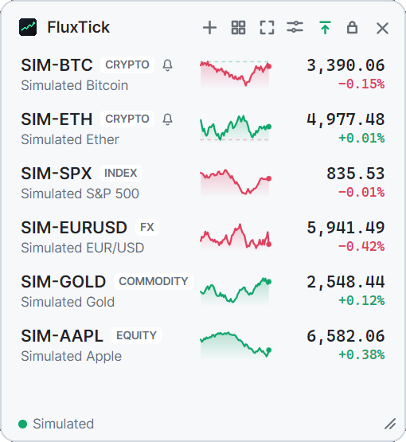
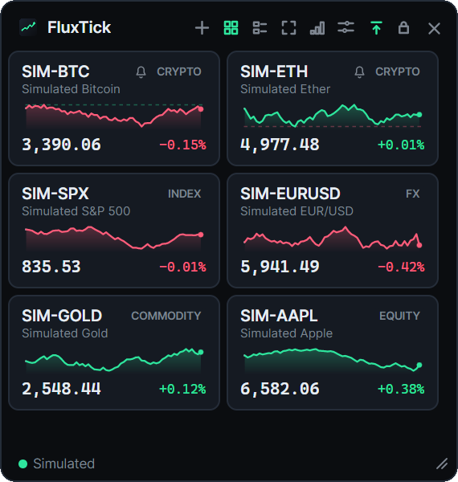
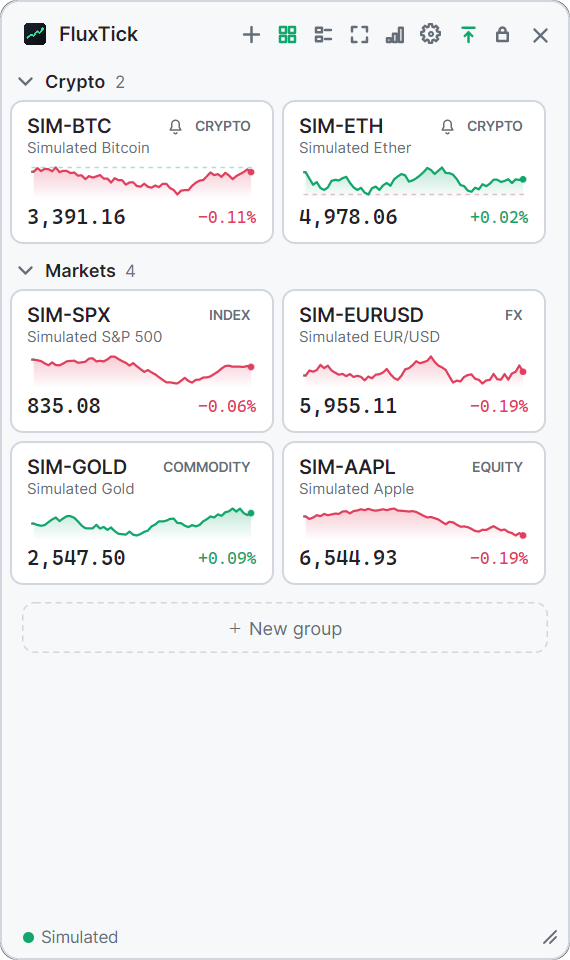
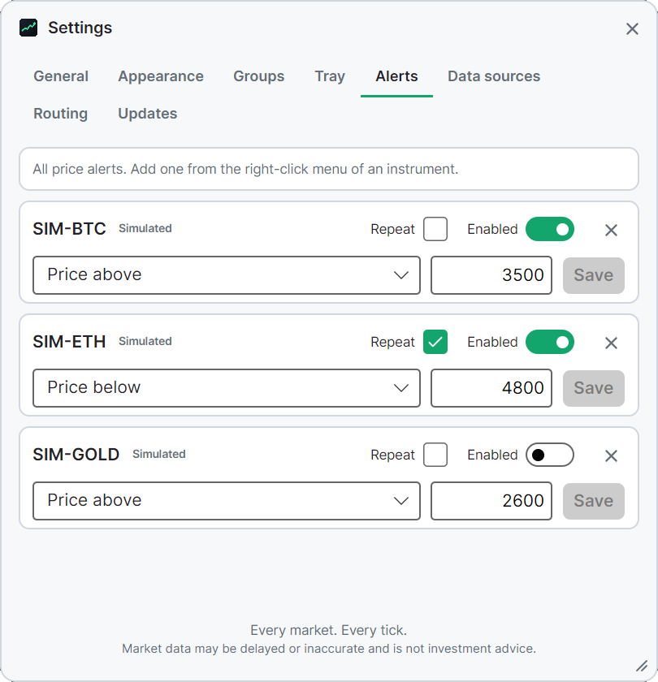

# FluxTick

[](https://github.com/coldhighsun/FluxTick/actions/workflows/ci.yml)
[](https://github.com/coldhighsun/FluxTick/releases)
[](LICENSE)
[](https://dotnet.microsoft.com/download)
[](https://avaloniaui.net/)
[](#getting-started)

**English** | [简体中文](README.zh-CN.md)

**Every market. Every tick.**

A lightweight, open-source desktop widget for tracking multiple financial markets at a glance.
Real-time numbers, tiny sparklines and a floating always-on-top window. Stocks, crypto, forex, indices and
commodities side by side, from the data sources *you* choose.

<p align="center">
  
  
</p>
<p align="center">
  
  
</p>

> Screenshots use the built-in simulated data source (`--demo`).

## Features

- **Multi-asset watchlist**: crypto, equities & ETFs, indices, forex and commodities in one list.
- **List or cards**: switch the watchlist to fixed-size cards that flow onto as many columns as the window is wide.
  Group the cards by asset class, by data source or into your own groups; every group collapses on its own, and
  cards can be dragged to reorder them or to move them between your groups. The layout and the grouping switch
  from the header, and new groups are created right where you are working.
- **Live prices**: optional rolling of the price number on every change (the old price slides out upwards and the new one in from below when the price rises, the other way round when it falls; off by default, turn it on in Settings), 60-minute sparklines drawn along the time (a gray dashed line where no price came in, such as before the first price or after the market closed), change vs. previous close / 24h open.
- **Price alerts**: right-click an instrument and choose **Price alerts…** to be told when its price rises to or falls
  to a price. An alert fires once when the condition comes true (or every time it comes true again, if you choose
  **Repeat**), shows a small notification at the corner of the screen, makes the card or row of the instrument flash for a few seconds, and keeps the data sources connected while it is on, even when the window is hidden.
- **Floating widget**: borderless, translucent, always on top, draggable, resizable, lockable; can hide at a screen edge and hides to the tray.
- **You pick the data source**: enable or disable sources, tune their options and choose the default source per
  asset class in **Settings**. Move any instrument to another source with **Change data source…**.
- **Honest about data quality**: rows show `Stale`, `Reconnecting`, `Source off` instead of silently showing old prices. A price is `Stale` when nothing came in for the stale threshold (one minute by default), or when what keeps coming in was traded longer ago than that (a closed market).
- **Language**: Simplified Chinese or English, switchable at runtime; Auto follows the system language.
- **Up/down colors**: green-up or red-up, automatic by UI language (red-up for Chinese).
- **Cross-platform**: Windows, Linux and macOS (built on [Avalonia](https://avaloniaui.net/) and .NET 10).
- **Extensible**: adding a data source is one small class library and one line of registration.
  See [docs/ADDING_A_PROVIDER.md](docs/ADDING_A_PROVIDER.md).

## Built-in data sources

| Source | Covers | Mode | Notes |
| --- | --- | --- | --- |
| **Binance** | Crypto spot pairs | WebSocket stream (~1 s) | No API key. If `binance.com` is blocked on your network, set the endpoints to `wss://data-stream.binance.vision/ws` and `https://data-api.binance.vision` in Settings. |
| **Yahoo Finance** | Stocks, ETFs, indices, forex, futures | Polling (default 5 s) | Unofficial API; may be rate limited, delayed or change without notice. No API key. |
| **Tencent Finance** | A-shares, Hong Kong and US stocks, ETFs, indices | Polling (default 5 s) | Unofficial API; may be delayed or change without notice. No API key. Search by name, code or pinyin. Minute history (the sparkline backfill) covers A-shares and Hong Kong only; US stocks fill their sparkline from live ticks. Off by default. |
| **OKX** | Crypto spot pairs | WebSocket stream | No API key. Off by default. |
| **Coinbase** | Crypto spot pairs | WebSocket stream | Coinbase Exchange. No API key. Off by default. |
| **Kraken** | Crypto spot pairs | WebSocket stream | No API key. Off by default. |
| **Bybit** | Crypto spot pairs | WebSocket stream | No API key. Not served in some regions. Off by default. |
| **Simulated** | Anything | Local random walk | For demos, screenshots and offline development. Off by default. |

Sources that are off by default are enabled in **Settings → Data sources**. To show an instrument from one of them,
pick it in the *Add instrument* window or make it the default for an asset class on the *Routing* tab.

> Market data may be delayed or inaccurate and is **not investment advice**. FluxTick is not affiliated with any of
> the data providers. Respect each provider's terms of use.

## Getting started

### Download

Grab the latest build from the [Releases](https://github.com/coldhighsun/FluxTick/releases) page:

- **Windows:** `FluxTick-<version>-win-x64-setup.exe` installs for the current user (no administrator rights needed).
  Uninstalling keeps your settings in `%APPDATA%\FluxTick`. A portable `FluxTick-<version>-win-x64.zip` is also available.
- **Linux / macOS:** `FluxTick-<version>-linux-x64.zip` / `FluxTick-<version>-osx-arm64.zip`.

The installer is not code-signed, so Windows SmartScreen may warn on first run.

### Run from source

Requires the [.NET 10 SDK](https://dotnet.microsoft.com/download).

```bash
dotnet run --project src/FluxTick.App
```

Try it without network access:

```bash
dotnet run --project src/FluxTick.App -- --demo
```

### Build a single-file executable

```bash
dotnet publish src/FluxTick.App -c Release -r win-x64 -o publish
```

Use `linux-x64`, `osx-arm64` and so on for other platforms. The result is a self-contained `FluxTick` /
`FluxTick.exe`.

### Use it

| Action | How |
| --- | --- |
| Move the window | Drag the header (unless *Lock position* is on). The header's arrow-to-a-bar button keeps the window always on top; the padlock button locks its position |
| Resize | Drag the bottom-right grip. In the list layout the width is fixed (340 px, or 260 px in compact mode) and only the height changes; in the card layout the width is free and remembered |
| Add an instrument | **+** in the header, or *Add instrument…* in the right-click menu of the empty area, opens a window; pick an asset class and a data source, search || Reorder | Drag a row up or down |
| Remove, change source | Right-click a row |
| Move the Settings / Add window | Drag its header; **Esc** closes it |
| Settings | The gear icon in the header, *Settings* in the tray menu, or *Settings* at the bottom of the right-click menu of the empty area opens a window with the tabs *General*, *Appearance*, *Groups*, *Tray* (Windows only), *Alerts*, *Data sources*, *Routing* and *Updates*; expand a data source to edit its options, and manage your price alerts under *Alerts* |
| Launch at startup | Windows only, off by default; turn on *Launch at startup* under Settings → General to start FluxTick when you sign in |
| Start in the tray | Off by default; *Start in the tray* under Settings → General (or the `--minimized` command line option) keeps the window hidden at startup until you double-click the tray icon (click it where the system cannot list the instruments, which is anywhere but Windows) |
| Single instance | Only one copy runs per user; starting FluxTick again brings the running window forward (even when it is hidden in the tray) instead of opening a second one |
| Close button | By default the close button hides the window to the tray; turn off *Close button hides to tray* under Settings → General to exit instead |
| Tray menu | Right-click the tray icon for *Show / hide*, *Settings*, *About* and *Exit*; *Settings* replaces a window that is already open, and *About* opens on its own without showing the main window |
| Connect data sources on demand | On by default. The data sources are only connected while the window or the tray list is shown (not minimized, not hidden to the tray, not tucked away at a screen edge) and for 30 seconds after, so a tray-only app keeps no connections open. Prices do not update while hidden. **The cost is a short wait:** when you show the window again, or click the tray icon to open the list after the app was hidden for a while, the sources have to reconnect first. That takes a moment (a second or so, longer on a slow network or with a source that is slow to answer), during which the last prices show dimmed as `Stale`, and in an app that started hidden in the tray, the rows have no price at all until the first quote arrives. Showing the window again within 30 seconds of hiding it does not reconnect. If you would rather have prices always ready, turn off *Connect data sources on demand* under Settings → General to keep the sources connected all the time (at the cost of keeping network connections open while the app sits in the tray) |
| Tray list | Windows only; click the tray icon to see the instruments on your tray list (up to five) with their prices and changes, without opening the window. The list starts empty: right-click an instrument in the window and choose *Add to tray list* (or *Remove from tray list*), then drag the instruments into the order you want, or remove them, under Settings → Tray. An instrument whose prices stopped is dimmed and shows why. It closes when you click elsewhere or press Esc, and another click on the icon closes it too. Double-click the icon to open the window instead. Resting the pointer on the icon only shows the name and slogan of the app. |
| Restore a data source | *Restore defaults* in its expanded card puts its options back to the built-in values (secret values such as keys are kept) |
| Data source status | The footer shows one dot per data source in use (green connected, orange off or failing, grey idle, paused or reconnecting; *Paused* means the source is disconnected on purpose because nothing shows prices, see *Connect data sources on demand*). Sources with a problem come first; when not all fit, a **+N** chip appears. Click the footer to list every source with its state and error message |
| Full screen | Double-click the header to fill the whole screen; double-click it again or press Esc to go back. The size and position you had are kept: every way out of full screen (Esc, a double-click on the header, the full screen button) puts the window back as it was, and dragging the header in full screen takes the window out of it at that size and carries on dragging it. Choosing the list layout while in full screen leaves it at the list's fixed width instead. If you quit while in full screen, the window is full screen again at the next start. The settings, add-instrument, about and alert windows open in the middle of the screen while in full screen |
| Compact mode | Hides the charts of the list layout. Use *Compact* in the right-click menu of the empty area (list layout only), or toggle in Settings |
| Card layout | The grid button in the header switches between list and cards (also in the right-click menu of the empty area, and in Settings → Appearance → *Layout*). |
| Card size | In card layout, pick *Small*, *Medium* or *Large* from the card size button in the header, from *Card size* in the right-click menu of the empty area, or in Settings → Appearance → *Card size*. Small cards show only the symbol and the price (everything else is in the tooltip), medium is the usual card, and large adds a taller chart, the change in amount and percent, the reference price and the 60-minute low and high |
| Group cards | In card layout the header's grouping button (or the right-click menu of the empty area, or Settings → Appearance → *Card grouping*) picks *No grouping*, *By type*, *By data source* or *Custom groups*; click a group header to collapse or expand it, press and drag a type or custom group header to reorder the groups |
| Custom groups | A *Default* group exists from the start and new instruments join the first group. With *Custom groups* active, create a group from the grouping button → *New group…*, from the right-click menu of the empty area, from a card's right-click menu (*Move to new group…* puts that card into it), or from the dashed *New group* placeholder below the last group, which also accepts a dragged card. Double-click a group header to rename it, or right-click it for *Rename…* and *Delete group*; a group can be deleted there only while it has no instruments and is not the last group (an empty group also shows a *Delete group* link). Moving a card to a new group (its right-click menu) while another grouping is active switches to *Custom groups*; an *Undo* hint offers to switch back. Reorder groups by pressing and dragging them in Settings → Groups, where you can also delete them (there, deleting a group moves its instruments to the first remaining one); right-click a card → *Move to group*, or drag the card onto a group |
| Price roll | Off by default; turn *Roll the price on change* on in the right-click menu of the empty area, or in Settings → Appearance. Only the price number rolls (up for a rise, down for a fall); the whole card or row flashing for a few seconds is the sign of an alert that fired, and it does not depend on this setting |
| Edge auto-hide | On by default; turn *Auto-hide at screen edge* off in Settings → General (it needs the always-on-top setting, and is not available where the system does not let a window leave the screen, because it does not keep a window beyond the screen edge). Drop the window at the left, right or top edge of the screen and it slides away, leaving a thin strip; point at the strip, or double-click the tray icon, to bring it back. After you point at the window and move away it hides again; a window brought out with the tray icon stays until you choose *Show / hide* in the tray menu |
| Hide / show | The window has no taskbar button (and is not in Alt+Tab) while the tray icon is available; if the system has no tray, it keeps its taskbar button. **×** hides to the tray (or exits when *Close button hides to tray* is off); double-click the tray icon to bring it back (also when the window was minimized; where the tray icon cannot list the instruments, a single click shows and hides the window instead); *Show / hide* in the tray menu hides it again; *Exit* in the tray menu quits |

Settings and logs live in `%APPDATA%\FluxTick` on Windows and `~/.config/FluxTick` on Linux and macOS. Logs are in the `logs` folder: one file per day, split earlier when a file reaches 10 MB, and only the newest 5 files are kept (so at most the last 5 days, fewer on a busy day). Older files are deleted automatically. A problem that repeats with every price update, such as a failing handler, is written at most once a minute, with the number of repeats that were held back.
Options that are at their built-in default are not written to `settings.json`. Delete it to reset everything.

## Project layout

```
src/FluxTick.Abstractions        Stable provider contracts (the only thing a data source references)
src/FluxTick.Core                Provider registry, routing, quote aggregation, sparkline series, settings
src/FluxTick.Providers.Common    Helpers shared by data sources (WebSocket and polling base classes, symbol search)
src/FluxTick.Providers.Binance   Binance WebSocket source
src/FluxTick.Providers.Okx       OKX WebSocket source
src/FluxTick.Providers.Coinbase  Coinbase WebSocket source
src/FluxTick.Providers.Kraken    Kraken WebSocket source
src/FluxTick.Providers.Bybit     Bybit WebSocket source
src/FluxTick.Providers.Yahoo     Yahoo Finance polling source
src/FluxTick.Providers.Tencent   Tencent Finance polling source
src/FluxTick.Providers.Simulated Deterministic demo source
src/FluxTick.App                 Avalonia desktop app (FluxTick.exe), composition root
tests/                           xUnit v3 + AwesomeAssertions
```

```bash
dotnet build FluxTick.slnx
dotnet test --solution FluxTick.slnx
```

## Contributing

Issues and pull requests are welcome. Please add or update tests with your change. New data sources are the most
useful contribution; start with [docs/ADDING_A_PROVIDER.md](docs/ADDING_A_PROVIDER.md).

## License

[MIT](LICENSE)
