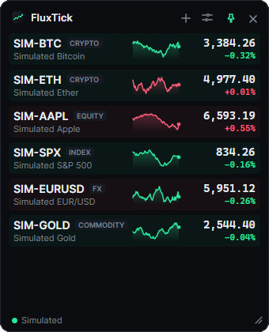
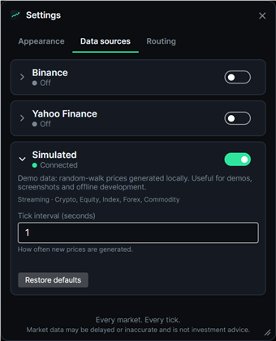
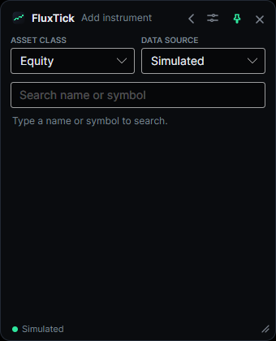

# FluxTick

[](https://github.com/coldhighsun/FluxTick/actions/workflows/ci.yml)
[](https://github.com/coldhighsun/FluxTick/releases)
[](LICENSE)
[](https://dotnet.microsoft.com/download)
[](https://avaloniaui.net/)
[](#快速开始)
[](#参与贡献)

[English](README.md) | **简体中文**

**每个市场，每一次跳动。**

一款轻量、开源的桌面小组件，让你一眼掌握多个金融市场的行情。
实时数字、迷你走势图和置顶悬浮窗口；股票、加密货币、外汇、指数与大宗商品并列展示，数据源由*你*自己选择。

<p align="center">
  
  
  
</p>

> 截图使用内置的模拟数据源（`--demo`）。

## 功能特性

- **多资产自选列表**：加密货币、股票与 ETF、指数、外汇和大宗商品集中在同一个列表中。
- **列表或卡片**：可把自选列表切换为固定大小的卡片，窗口越宽，一行排得越多，放不下的自动换到下一行。
  卡片可按资产类型、数据源分组，也可放进自己创建的分组；每个分组都能单独折叠 / 展开，
  还可以拖动卡片调整顺序，或把卡片拖到其他自定义分组。布局和分组方式可直接在标题栏切换，
  新分组也能在当前操作的位置就地创建。
- **实时价格**：可选的变动闪烁提示（默认关闭，可在设置中开启），60 分钟迷你走势图，显示相对前收盘价 / 24 小时开盘价的涨跌幅。
- **悬浮小组件**：无边框、半透明、始终置顶，可拖动、可缩放、可锁定位置，并可隐藏到托盘。
- **数据源由你决定**：在**设置**中启用或停用数据源、调整其选项，并为每类资产指定默认数据源。
  还可以通过 **更换数据源…** 把任意品种切换到其他数据源。
- **如实呈现数据质量**：行情行会显示 `Stale`（过期）、`Reconnecting`（重连中）、`Source off`（数据源已关闭），
  而不是悄悄展示旧价格。
- **涨跌颜色**：绿涨红跌或红涨绿跌，根据界面语言自动选择（中文为红涨绿跌）。
- **跨平台**：支持 Windows、Linux 和 macOS（基于 [Avalonia](https://avaloniaui.net/) 与 .NET 10 构建）。
- **易于扩展**：新增一个数据源只需一个小型类库和一行注册代码。
  参见 [docs/ADDING_A_PROVIDER.md](docs/ADDING_A_PROVIDER.md)（英文）。

## 内置数据源

| 数据源 | 覆盖范围 | 模式 | 说明 |
| --- | --- | --- | --- |
| **Binance** | 加密货币现货交易对 | WebSocket 推送（约 1 秒） | 无需 API Key。如果所在网络无法访问 `binance.com`，请在设置中把端点改为 `wss://data-stream.binance.vision/ws` 和 `https://data-api.binance.vision`。 |
| **Yahoo Finance** | 股票、ETF、指数、外汇、期货 | 轮询（默认 5 秒） | 非官方 API，可能被限流、延迟，或在没有通知的情况下变更。无需 API Key。 |
| **Tencent Finance（腾讯财经）** | A 股、港股、美股、ETF、指数 | 轮询（默认 5 秒） | 非官方 API，可能存在延迟，或在没有通知的情况下变更。无需 API Key。支持按名称、代码或拼音搜索。分时历史（走势图回填）仅覆盖 A 股和港股，美股的走势图只能由实时报价逐步填充。默认关闭。 |
| **OKX** | 加密货币现货交易对 | WebSocket 推送 | 无需 API Key。默认关闭。 |
| **Coinbase** | 加密货币现货交易对 | WebSocket 推送 | Coinbase Exchange。无需 API Key。默认关闭。 |
| **Kraken** | 加密货币现货交易对 | WebSocket 推送 | 无需 API Key。默认关闭。 |
| **Bybit** | 加密货币现货交易对 | WebSocket 推送 | 无需 API Key。部分地区无法访问。默认关闭。 |
| **Simulated（模拟）** | 任意品种 | 本地随机游走 | 用于演示、截图和离线开发。默认关闭。 |

默认关闭的数据源请在**设置 → 数据源**中启用。要显示其中的品种，可以在*添加品种*窗口中选择它，
或在*路由*标签页中把它设为某类资产的默认数据源。

> 行情数据可能存在延迟或误差，**不构成投资建议**。FluxTick 与任何数据提供方均无关联，
> 请遵守各数据提供方的使用条款。

## 快速开始

### 从源码运行

需要 [.NET 10 SDK](https://dotnet.microsoft.com/download)。

```bash
dotnet run --project src/FluxTick.App
```

无需联网也可以体验：

```bash
dotnet run --project src/FluxTick.App -- --demo
```

### 构建单文件可执行程序

```bash
dotnet publish src/FluxTick.App -c Release -r win-x64 -o publish
```

其他平台请使用 `linux-x64`、`osx-arm64` 等运行时标识符。产物是自包含的 `FluxTick` / `FluxTick.exe`。

### 使用方法

| 操作 | 方式 |
| --- | --- |
| 移动窗口 | 拖动标题栏（开启*锁定位置*时除外）。标题栏上“箭头指向横条”的按钮用于窗口置顶，挂锁按钮用于锁定位置 |
| 调整大小 | 拖动右下角的拖拽柄。列表布局下宽度固定（340 px，紧凑模式 260 px），只能调高度；卡片布局下宽度可自由调整，并会被记住 |
| 添加品种 | 点击标题栏的 **+**，或在空白处右键选 *Add instrument…*，打开窗口，选择资产类别和数据源后搜索 |
| 调整顺序 | 上下拖动某一行 |
| 删除、更换数据源 | 右键点击某一行 |
| 移动设置 / 添加窗口 | 拖动其标题栏；按 **Esc** 关闭 |
| 设置 | 点击标题栏的滑块图标打开窗口，包含*外观*、*数据源*和*路由*三个标签页；展开某个数据源即可编辑其选项 |
| 恢复数据源默认值 | 在数据源展开的卡片中点击*恢复默认*，其选项会回到内置值（密钥等机密值会保留） |
| 数据源状态 | 底栏为每个在用的数据源显示一个圆点（绿色表示已连接，橙色表示未启用或出错，灰色表示空闲或重连中）。有问题的数据源排在最前；放不下时会出现 **+N** 标签。点击底栏可查看每个数据源的状态和错误信息 |
| 紧凑模式 | 双击标题栏，在空白处右键菜单选 *Compact*，或在设置中切换 |
| 卡片布局 | 点击标题栏的网格按钮在列表和卡片之间切换（在空白处右键菜单、或设置 → 外观 → *Layout* 里也可以切换）；*Compact* 会隐藏走势图并让卡片变小 |
| 卡片分组 | 卡片布局下，点击标题栏的分组按钮（或在空白处右键，或设置 → 外观 → *Card grouping*）可选 *No grouping*（不分组）、*By type*（按类型）、*By data source*（按数据源）或 *Custom groups*（自定义分组）；点击分组标题可折叠 / 展开，按住类型分组或自定义分组的标题拖动可调整分组顺序 |
| 自定义分组 | 一开始就有一个 *Default* 分组，新添加的品种进入第一个分组。新建分组的入口：分组按钮 → *New group…*、空白处右键菜单、卡片右键菜单（*Move to new group…* 会把这张卡放进新分组）、最后一个分组下方的虚线 *New group* 占位（也可以把卡片拖到它上面）。双击分组标题可就地改名；右键分组标题可选 *Rename…*（重命名）和 *Delete group*（删除分组），只有没有品种、且不是最后一个的分组才能在这里删除（空分组下方也有 *Delete group* 链接）。在其他分组方式下新建分组会自动切到 *Custom groups*，并出现 *Undo*（撤销）提示可切回去。在设置 → Groups 中可以按住分组拖动排序，也可以删除分组（在那里删除分组，其品种会移入剩余的第一个分组）；右键卡片选 *Move to group*，或直接把卡片拖到分组里 |
| 价格闪烁 | 默认关闭；在空白处右键菜单，或设置 → 外观中开启 *Flash on price change* |
| 隐藏 / 显示 | 点击 **×** 隐藏到托盘；点击托盘图标重新显示；托盘菜单中的*退出*用于关闭程序 |

设置和日志保存在 Windows 的 `%APPDATA%\FluxTick`，以及 Linux 和 macOS 的 `~/.config/FluxTick`。
处于内置默认值的选项不会写入 `settings.json`。删除该文件即可重置全部设置。

## 项目结构

```
src/FluxTick.Abstractions        稳定的数据源契约（数据源只需引用它）
src/FluxTick.Core                数据源注册、路由、行情聚合、走势序列、设置
src/FluxTick.Providers.Common    数据源共用的辅助代码（WebSocket 循环、符号搜索）
src/FluxTick.Providers.Binance   Binance WebSocket 数据源
src/FluxTick.Providers.Okx       OKX WebSocket 数据源
src/FluxTick.Providers.Coinbase  Coinbase WebSocket 数据源
src/FluxTick.Providers.Kraken    Kraken WebSocket 数据源
src/FluxTick.Providers.Bybit     Bybit WebSocket 数据源
src/FluxTick.Providers.Yahoo     Yahoo Finance 轮询数据源
src/FluxTick.Providers.Tencent   腾讯财经轮询数据源
src/FluxTick.Providers.Simulated 确定性的演示数据源
src/FluxTick.App                 Avalonia 桌面应用（FluxTick.exe），组合根
tests/                           xUnit v3 + AwesomeAssertions
```

```bash
dotnet build FluxTick.slnx
dotnet test --solution FluxTick.slnx
```

## 参与贡献

欢迎提交 Issue 和 Pull Request。请随改动一并添加或更新测试。新增数据源是最有价值的贡献，
请从 [docs/ADDING_A_PROVIDER.md](docs/ADDING_A_PROVIDER.md)（英文）开始。

## 许可证

[MIT](LICENSE)
