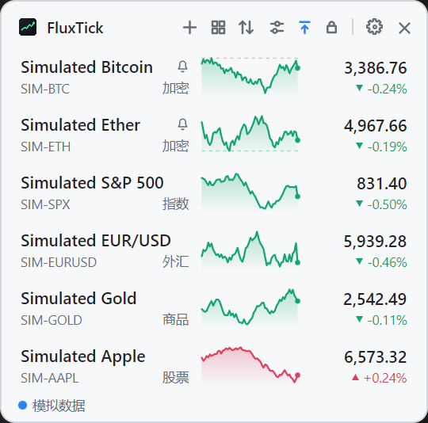
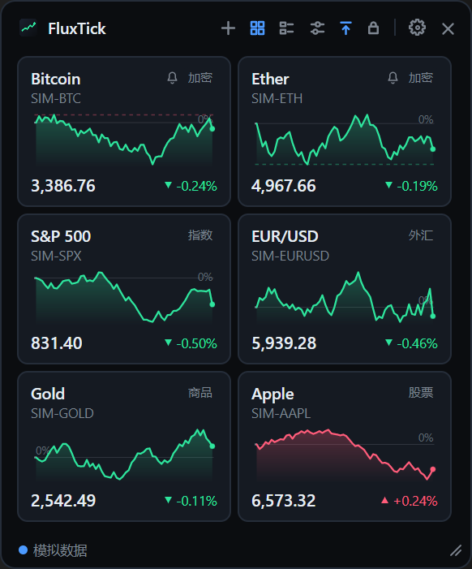
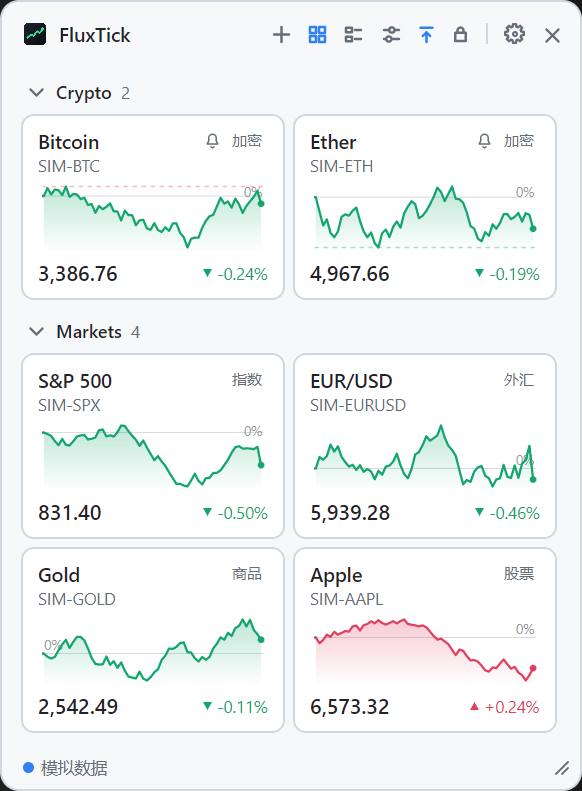
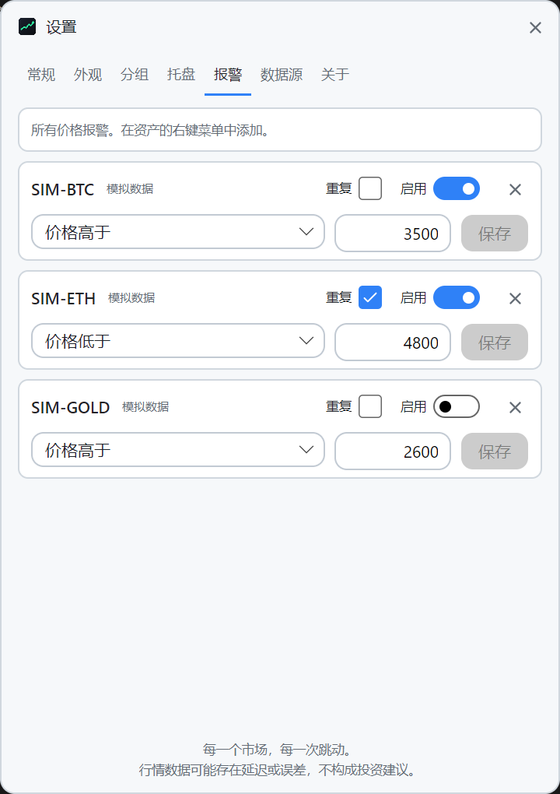
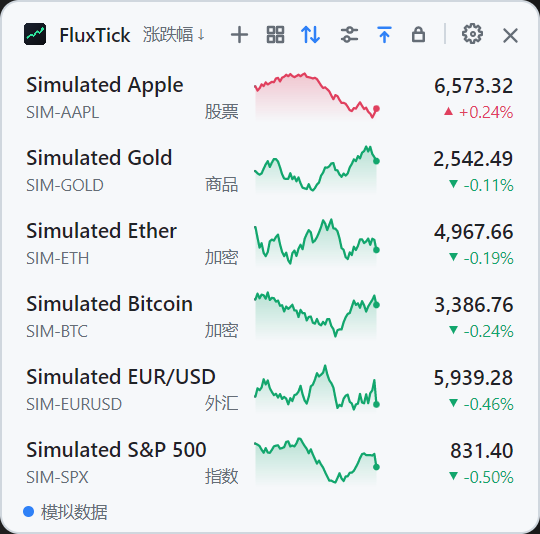
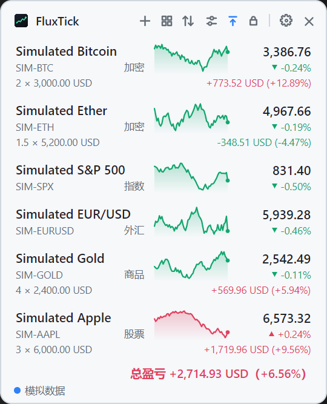
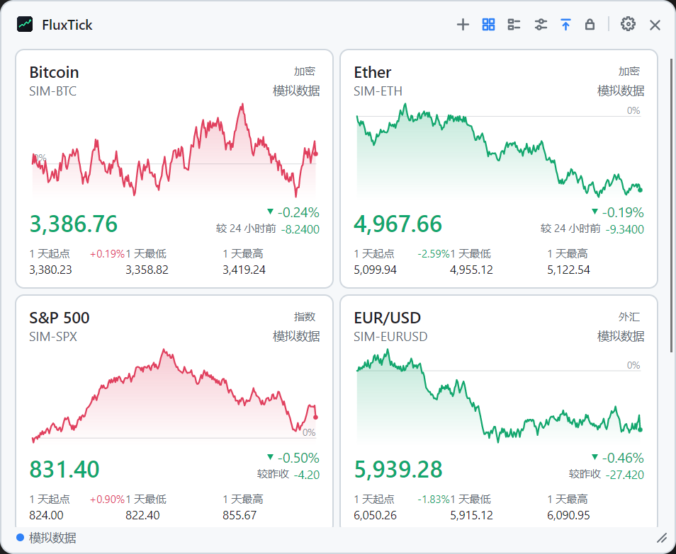
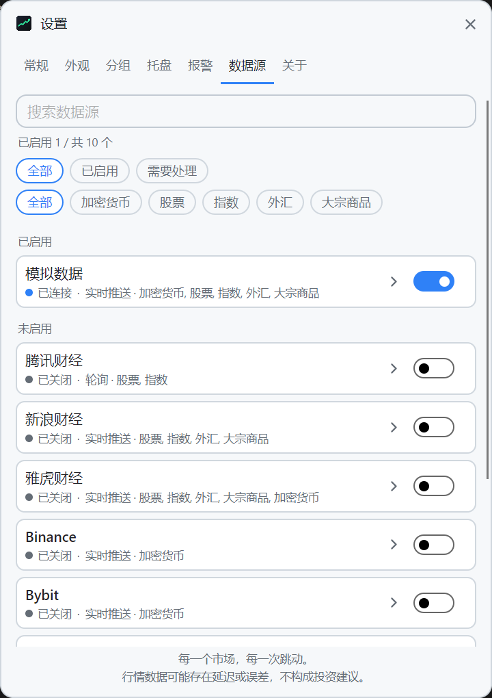
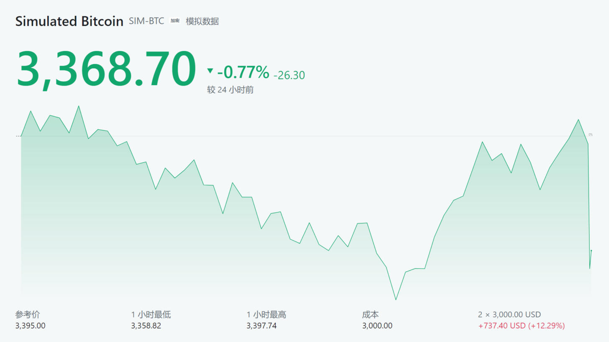

<div align="center">


# FluxTick

[](https://github.com/coldhighsun/FluxTick/actions/workflows/ci.yml)
[](https://codecov.io/gh/coldhighsun/FluxTick)
[](tests)
[](https://github.com/coldhighsun/FluxTick/releases/latest)
[](https://github.com/coldhighsun/FluxTick/releases)
[](https://github.com/coldhighsun/FluxTick/releases)
[](https://github.com/coldhighsun/FluxTick/issues)
[](https://github.com/coldhighsun/FluxTick/pulls)
[](https://github.com/coldhighsun/FluxTick/commits/main)
[](https://github.com/coldhighsun/FluxTick/stargazers)
[](LICENSE)
[](https://dotnet.microsoft.com/download)
[](https://avaloniaui.net/)
[](#快速开始)

[English](README.md) | 简体中文 | [繁體中文](README.zh-TW.md)

</div>

---

**每个市场，每一次跳动。**

一款轻量、开源的桌面小组件，让你一眼掌握多个金融市场的行情。
实时数字、迷你走势图和置顶悬浮窗口；股票、加密货币、外汇、指数与大宗商品并列展示，数据源由*你*自己选择。

<p align="center">
  
  
</p>
<p align="center">
  
  
</p>

<p align="center">
  
  
</p>
<p align="center">
  
  
</p>
<p align="center">
  
</p>

> 截图使用内置的模拟数据源（`--demo`）。

## 功能特性

- **多资产自选列表**：加密货币、股票与 ETF、指数、外汇和大宗商品集中在同一个列表中。
- **列表或卡片**：可把自选列表切换为卡片，窗口越宽，一行排得越多。卡片可按资产类型、数据源分组，
  也可放进自己创建的分组；每个分组都能单独折叠 / 展开，卡片可拖动排序，或拖到其他分组。
- **实时价格**：迷你走势图（按时间绘制，没有报价的时段画成虚线），显示相对前收盘价 / 24 小时开盘价的涨跌幅，
  另有可选的价格数字滚动动画（默认关闭）。
- **走势图时间跨度**：走势图默认显示最近一小时，点击标题栏的*视图*按钮（两个滑块图标）可切换为 1 天、5 天、1 个月、6 个月或 1 年，
  并显示百分比坐标轴、悬停提示和该跨度内的涨跌。不支持更长跨度的数据源仍显示最近一小时。
- **品种全屏展示**：在品种上右键选择**全屏展示**，让它独占整个显示器：大号价格、涨跌幅、大图走势（带悬停提示，
  时间跨度跟随你的选择）、参考价、区间最低/最高价以及你的持仓。画面随每一次跳动实时更新；多显示器时，
  每个品种可各占一块屏幕。
- **列表排序**：列表布局可按日涨跌幅或持仓盈亏百分比排序，休市的行排在开市的行之后。
- **市场状态**：行情行按交易所交易时间显示盘前、盘后、午休和休市。
- **价格报警**：右键点击资产并选择**价格报警…**，价格涨到或跌到某个价位时收到提醒。
  报警触发一次（勾选**重复**则每次重新成立都会触发），弹出小通知并让该卡片或行闪烁；窗口隐藏后报警照常工作。
- **持仓与盈亏**：右键点击资产并选择**持仓成本…**，填写成本价、数量和币种，行、卡片、悬停提示和托盘弹窗就会显示盈亏；
  总盈亏按你选择的基准币种（设置 → 常规）汇总。汇率来自免费的 [Frankfurter](https://frankfurter.dev) 服务
  （欧洲央行参考汇率），每小时更新一次。价格已过期或数据源出错的持仓不计入总额，总额后面会注明有几项。
- **悬浮小组件**：无边框、半透明、始终置顶，可拖动、可缩放、可锁定位置，可贴边自动隐藏，并可隐藏到托盘。
- **数据源由你决定**：在**设置**中启用或停用数据源、调整其选项，并为每类资产指定默认数据源。
  还可以通过 **更换数据源…** 把任意资产切换到其他数据源。
- **如实呈现数据质量**：行情行会显示 `Stale`（过期）、`Delayed`（报价延迟）、`Reconnecting`（重连中）或 `Source off`（数据源已关闭），
  而不是悄悄展示旧价格。持续收到数据但价格是更早之前成交的（超过过期阈值，默认一分钟，且不超过 30 分钟，例如延迟行情），即为延迟；
  超过阈值没有收到数据，或收到的价格已是 30 分钟前成交的（例如源卡住、休市），即为过期。
  过期的价格不计入持仓总额（休市除外），延迟的价格仍会计入；数据源过期、延迟或重连期间报警会等待。
- **界面语言**：简体中文、繁体中文或英文，可在运行时切换；“自动”跟随系统语言。
- **涨跌颜色**：绿涨红跌或红涨绿跌，根据界面语言自动选择（中文为红涨绿跌）。
- **跨平台**：支持 Windows、Linux 和 macOS（基于 [Avalonia](https://avaloniaui.net/) 与 .NET 11 构建）。
- **易于扩展**：新增一个数据源只需一个小型类库和一行注册代码。
  参见 [docs/ADDING_A_PROVIDER.md](docs/ADDING_A_PROVIDER.md)（英文）。

## 内置数据源

| 数据源 | 覆盖范围 | 模式 | 说明 |
| --- | --- | --- | --- |
| **Binance** | 加密货币现货交易对 | WebSocket 推送（约 1 秒） | 无需 API Key。如果无法访问 `binance.com`，请在设置中把端点改为 `wss://data-stream.binance.vision/ws` 和 `https://data-api.binance.vision`。 |
| **Yahoo Finance** | 股票、ETF、指数、外汇、期货、加密货币 | WebSocket 推送 | 非官方 API，可能被限流或无通知变更。无需 API Key。**A 股和港股行情有 15 分钟延迟**，因此会显示为报价延迟；需要 A 股实时行情请使用新浪或腾讯。推送中断期间改为轮询图表 API（默认 5 秒）。 |
| **Tencent Finance（腾讯财经）** | A 股、港股、美股、ETF、指数 | 轮询（默认 5 秒） | 非官方 API，可能延迟或无通知变更。无需 API Key。支持按名称、代码或拼音搜索。走势图历史仅覆盖 A 股和港股。默认关闭。 |
| **Sina Finance（新浪财经）** | A 股、ETF、指数、外汇、国际商品期货 | WebSocket 推送 | 非官方 API，可能被限流、延迟或无通知变更。无需 API Key。代码格式与腾讯相同（如 `sh600000`），但自选标的会固定在添加时的数据源。可搜索股票、主要指数和常用外汇、期货；ETF 需直接输入代码，其他外汇（`fx_seurusd`）和期货（`hf_GC`）输入新浪的代码。走势图历史覆盖 A 股、基金和外汇。默认关闭。 |
| **Eastmoney（东方财富）** | A 股、港股、美股、ETF、指数 | 事件流推送（每个品种一条连接） | 非官方接口，可能延迟或随时变动。推送中断期间由批量行情接口提供首个价格和备用行情（默认 5 秒）。无需 API Key。代码写作 `市场.代码`（`1.600519`、`116.00700`、`105.AAPL`），可通过名称、代码或拼音搜索自动填入。默认关闭。 |
| **Eulerpool** | 全球股票和 ETF（代码带交易所后缀，如 `AAPL`、`SAP.DE`） | WebSocket 推送 | 需要 API Key（在 eulerpool.com/developers 免费申请，详见 [API Key](#api-key)）。免费 Key 只能收到延迟的 1 秒行情，实时成交需要付费套餐。支持按名称、代码或 ISIN 搜索。默认关闭。 |
| **Finnhub** | 美股和 ETF | WebSocket 推送 | 需要 API Key（在 finnhub.io 免费申请，详见 [API Key](#api-key)）。免费 Key 每分钟 60 次 REST 请求、可推送 50 个代码；推送提供美股实时成交，REST 提供首个价格和备用行情。免费套餐没有走势图历史，走势图由实时价格累积。支持按名称或代码搜索。默认关闭。 |
| **Massive** | 美股和 ETF | 轮询（默认 5 分钟） | 需要 API Key（在 massive.com 免费申请，详见 [API Key](#api-key)）。前身为 Polygon.io。免费套餐没有 WebSocket 和快照，因此应用轮询延迟的 1 分钟 K 线，每分钟 5 次请求（每个代码一到两次，间隔 13 秒）：不是实时行情，适合少量代码；付费套餐才有推送。走势图历史覆盖最近一小时，以及一个月及更长区间。支持按名称或代码搜索。默认关闭。 |
| **Twelve Data** | 全球股票、ETF 和指数 | WebSocket 推送 | 需要 API Key（在 twelvedata.com 免费申请，详见 [API Key](#api-key)）。行情通过 WebSocket 推送；REST（免费 Key 每分钟 8 点、每天 800 点，每个代码耗 1 点）提供首个价格，并在推送中断时作为备用。行情可能有延迟。支持按名称或代码搜索。默认关闭。 |
| **OKX** | 加密货币现货交易对 | WebSocket 推送 | 无需 API Key。默认关闭。 |
| **Coinbase** | 加密货币现货交易对 | WebSocket 推送 | Coinbase Exchange。无需 API Key。默认关闭。 |
| **Kraken** | 加密货币现货交易对 | WebSocket 推送 | 无需 API Key。默认关闭。 |
| **Bybit** | 加密货币现货交易对 | WebSocket 推送 | 无需 API Key。部分地区无法访问。默认关闭。 |
| **Gate.io** | 加密货币现货交易对 | WebSocket 推送 | 无需 API Key。默认关闭。 |
| **Bitget** | 加密货币现货交易对 | WebSocket 推送 | 无需 API Key。部分地区无法访问。默认关闭。 |
| **Crypto.com** | 加密货币现货交易对 | WebSocket 推送 | 无需 API Key。默认关闭。 |
| **KuCoin** | 加密货币现货交易对 | WebSocket 推送 | 无需 API Key（每次连接自动获取临时公开令牌）。默认关闭。 |
| **Simulated（模拟）** | 任意资产 | 本地随机游走 | 用于演示、截图和离线开发。默认关闭。 |

默认关闭的数据源请在**设置 → 数据源**中启用。要显示其中的资产，可以在*添加资产*窗口中选择它，
或在*数据源*标签页中拖动数据源排序：支持某类资产的、已启用的第一个数据源就是该类资产的默认数据源。

> 行情数据可能存在延迟或误差，**不构成投资建议**。FluxTick 与任何数据提供方均无关联，
> 请遵守各数据提供方的使用条款。

## 快速开始

### 下载

从 [Releases](https://github.com/coldhighsun/FluxTick/releases) 页面获取最新版本：

- **Windows：** `FluxTick-<版本>-win-x64-setup.exe` 为当前用户安装（无需管理员权限）。卸载时会保留 `%APPDATA%\FluxTick` 中的设置。
- **Windows（便携版）：** `FluxTick-<版本>-win-x64-portable.zip` 内只有一个 `FluxTick.exe`，解压到任意位置即可运行，无需安装。
- **Linux：** `FluxTick-<版本>-linux-x64.zip` 内只有一个 `FluxTick` 可执行文件。
- **macOS（Apple Silicon）：** `FluxTick-<版本>-osx-arm64.dmg` 内含 `FluxTick.app`，参见下方 [macOS 安装](#macos-安装)。
- **macOS（Homebrew）：** `brew install --cask coldhighsun/tap/fluxtick`

> **请勿在同一台电脑上同时使用便携版和安装版。** 两者共用 `%APPDATA%\FluxTick` 中的设置，并且各自注册指向自己
> `FluxTick.exe` 的*开机自启动*项，会互相冲突（登录时可能启动了错误的那一份，或启动项被覆盖）。内置更新功能
> 下载的是安装程序，便携版自动更新后也会变成安装版。请二选一；切换前先卸载安装版（或删除便携版文件夹）。

安装程序和便携版均未做代码签名，首次运行时 Windows SmartScreen 可能会提示。

#### macOS 安装

macOS 版本仅做了 ad-hoc 签名：没有 Apple Developer ID 签名，也未经公证。因此 macOS 的 Gatekeeper 会在首次启动时拦截
（提示“无法打开，因为无法验证开发者”或“已损坏”），不能直接双击运行，需要手动放行一次：

1. 打开 `.dmg`，把 `FluxTick.app` 拖到“应用程序”。
2. 从“应用程序”中打开 FluxTick，macOS 会拒绝并弹出提示。
3. 打开*系统设置 → 隐私与安全性*，滚动到关于 FluxTick 的提示，点击*仍要打开*并确认。（macOS 14 及更早版本也可以
   右键点击应用选择*打开*；macOS 15 起已移除该方式。）

通过 Homebrew 安装会自动移除隔离属性，安装后可直接打开：

```bash
brew install --cask coldhighsun/tap/fluxtick
```

之后 `brew upgrade` 即可升级到新的稳定版。

也可以在首次启动前，在终端中移除隔离属性：

```bash
xattr -dr com.apple.quarantine /Applications/FluxTick.app
```

macOS 上的注意事项：

- 仅构建 Apple Silicon（M1 及更新），没有 Intel 版本；需要 macOS 12 或更高版本。
- 老板键的用法与 Windows 相同，其中 *Win* 指 Command 键，*Alt* 指 Option 键（在设置文件中仍存为 `Win` 和 `Alt`），不需要额外授权。点击菜单栏图标会弹出资产列表，图标本身没有菜单，
  *显示/隐藏*、*设置*和*退出*放在列表底部。
- *开机自启动*会在 `~/Library/LaunchAgents/io.github.coldhighsun.FluxTick.plist` 创建一个启动代理，登录时启动应用。
  仅当 FluxTick 从固定位置（如“应用程序”）运行时可用，从挂载的 `.dmg` 或被隔离的下载文件中运行时不可用；移动应用后，该项会自动改指向当前运行的应用。
- API Key 使用保存在 macOS 钥匙串中的密钥加密（见下文“API Key”一节）；设置和日志在 `~/.config/FluxTick`。
- 程序是单文件自解压，首次启动可能多花几秒。
- 更新不会自动安装：FluxTick 只下载并校验新的 `.dmg` 并提示你，需自行替换“应用程序”中的 app。

Windows 上，FluxTick 在启动时以及运行期间约每天一次检查新版本（仅检查正式版，忽略预发布版），并提示下载、校验并安装新的安装程序，完成后自动重新启动。可在 设置 → 关于 中关闭。

### 从源码运行

需要 [.NET 11 SDK](https://dotnet.microsoft.com/download)。

```bash
dotnet run --project src/FluxTick.App
```

无需联网也可以体验：

```bash
dotnet run --project src/FluxTick.App -- --demo
```

### 构建单文件可执行程序

```bash
dotnet publish src/FluxTick.App -c Release -r win-x64 -o publish
```

其他平台请使用 `linux-x64`、`osx-arm64` 等运行时标识符。产物是自包含的 `FluxTick` / `FluxTick.exe`。

### 使用方法

| 操作 | 方式 |
| --- | --- |
| 移动窗口 | 拖动标题栏（开启*锁定位置*时除外）。标题栏上“箭头指向横条”的按钮用于窗口置顶，挂锁按钮用于锁定位置 |
| 调整大小 | 拖动右下角的拖拽柄。列表布局下宽度固定（340 px，紧凑模式 260 px），只能调高度；卡片布局下宽度可自由调整，并会被记住 |
| 添加资产 | 点击标题栏的 **+**，或在空白处右键选 *Add instrument…*，选择资产类别和数据源后搜索 |
| 调整顺序 | 上下拖动某一行 |
| 删除、更换数据源 | 右键点击某一行 |
| 移动设置 / 添加窗口 | 拖动其标题栏；按 **Esc** 关闭 |
| 设置 | 点击标题栏的齿轮图标、托盘菜单的*设置*，或空白处右键菜单最下面的*设置*。标签页：*常规*、*外观*、*分组*、*托盘*（仅 Windows）、*报警*、*数据源*和*关于*（更新设置也在这里）。展开某个数据源可编辑其选项，拖动数据源可调整优先级 |
| 开机自启动 | Windows 和 macOS，默认关闭；设置 → 常规。macOS 上需要应用从固定位置（如“应用程序”）运行 |
| 启动时最小化到托盘 | 默认关闭；设置 → 常规（或命令行参数 `--minimized`），启动时不显示窗口，双击托盘图标显示（不能在托盘图标上列出资产的系统，即 Windows 以外，单击即可） |
| 单实例 | 每个用户只运行一个实例；再次启动会把正在运行的窗口调到前面，即使它隐藏在托盘中 |
| 关闭按钮 | 默认隐藏到托盘；在设置 → 常规中关闭*关闭按钮隐藏到托盘*后直接退出 |
| 托盘菜单 | 右键点击托盘图标，可选*显示 / 隐藏*、*设置*和*退出* |
| 托盘列表 | 仅 Windows；单击托盘图标，无需打开窗口即可看到最多五个资产的价格和涨跌幅。右键点击资产选择*加入托盘列表*（或*从托盘列表移除*），在设置 → 托盘中调整顺序。价格停止更新的资产会变暗并显示原因。按 Esc 或点击其他位置关闭；双击图标打开主窗口 |
| 恢复数据源默认值 | 在数据源展开的卡片中点击*恢复默认*，其选项会回到内置值（密钥等机密值会保留） |
| 数据源状态 | 底栏为每个在用的数据源显示一个圆点（绿色已连接，橙色未启用或出错，灰色空闲或重连中），有问题的排在最前，放不下时出现 **+N** 标签。点击底栏可查看每个数据源的状态和错误信息 |
| 全屏 | 双击标题栏（或在标题栏*视图*菜单中选*全屏*，仅卡片布局）铺满屏幕；再次双击或按 Esc 返回原来的大小和位置。全屏时拖动标题栏会退出全屏并继续拖动。在全屏状态下退出，下次启动仍是全屏 |
| 品种全屏展示 | 在品种上右键选择*全屏展示*。画面铺满主窗口所在的显示器并随每次跳动更新，文字随屏幕高度放大。按 Esc 或双击关闭。同一品种只会打开一个（再次选择只是把它带到前台）；新打开的品种会去往还没有全屏画面的显示器，只有每块屏幕都有画面时，才会替换主窗口所在显示器上的那个。在空白处按住拖动，可把画面拖到另一块显示器：拖动时半透明，松手后铺满落点所在的显示器；若那块屏幕已有别的画面，则回到原来的显示器。老板键会和其他窗口一起隐藏并恢复这些画面 |
| 紧凑模式 | 隐藏列表布局中的走势图（空白处右键菜单，或设置） |
| 卡片布局 | 点击标题栏的网格按钮在列表和卡片之间切换（空白处右键菜单、设置 → 外观里也可以） |
| 卡片大小 | 卡片布局下，可在标题栏的*视图*菜单、右键菜单或设置 → 外观中选择*小*、*中*、*大*。小卡片只显示代码和价格（其余在悬停提示里），大卡片增加更高的走势图、涨跌额与涨跌幅、参考价以及 60 分钟最低 / 最高价 |
| 卡片分组 | 卡片布局下，点击标题栏的分组按钮（或右键菜单、设置 → 外观）可选*不分组*、*按类型*、*按数据源*或*自定义分组*。点击分组标题折叠 / 展开，拖动类型或自定义分组的标题可调整顺序 |
| 自定义分组 | 一开始就有一个 *Default* 分组，新资产进入第一个分组。新建分组：分组按钮 → *New group…*、空白处右键菜单，或卡片右键菜单的 *Move to new group…*。双击分组标题改名；右键分组标题可选 *Rename…* 和 *Delete group*（仅限没有资产且不是最后一个的分组）。移动卡片：右键 → *Move to group*，或直接拖到分组里。设置 → Groups 中可排序和删除分组（在那里删除，其资产会移入剩余的第一个分组） |
| 价格滚动 | 默认关闭；在空白处右键菜单或设置 → 外观中开启。只有价格数字会滚动；卡片或行闪烁表示有报警触发，与这个设置无关 |
| 贴边自动隐藏 | 默认开启（需要窗口置顶；在系统不让窗口留在屏幕外的环境下不可用），可在设置 → 常规中关闭。把窗口拖到屏幕左、右或上边缘后会滑出屏幕，只留一条细边；鼠标靠近细边或双击托盘图标时滑出，移开后再次隐藏（用托盘图标滑出的除外） |
| 隐藏 / 显示 | 有托盘图标时，窗口没有任务栏按钮（也不在 Alt+Tab 中）。点击 **×** 隐藏到托盘（或直接退出，见*关闭按钮*）；双击托盘图标重新显示（不能在托盘图标上列出资产的系统上单击即可）；托盘菜单的*退出*用于关闭程序。隐藏期间价格仍会更新，观察列表中有资产的数据源保持连接 |
| 老板键 | 全局快捷键（默认 **Ctrl+Alt+H**）一键隐藏所有窗口和托盘图标，再按一次恢复。在设置 → 常规中点击输入框后按下新的组合键即可修改（至少一个 Ctrl、Alt、Shift 或 Win，加上字母、数字、F 键、方向键、导航键或标点键；按退格键关闭；macOS 上 Win 指 Command 键）。隐藏期间行情照常更新，报警通知和更新提示会等窗口恢复后再弹出。仅限 Windows 和 macOS |

设置和日志保存在 Windows 的 `%APPDATA%\FluxTick`，以及 Linux 和 macOS 的 `~/.config/FluxTick`；设置 → 常规中有按钮可直接打开这些文件夹。日志每天一个文件（达到 10 MB 时提前拆分），只保留最新的 5 个文件。每次价格更新都会重复出现的问题每分钟最多记录一次。
处于内置默认值的选项不会写入 `settings.json`。每次保存前，原文件会保留为 `settings.json.bak`；设置文件缺失或损坏时会从它恢复。如需重置全部设置，请先退出程序，再同时删除 `settings.json` 和 `settings.json.bak`。

### API Key

部分数据源需要 API Key（目前有 Eulerpool、Twelve Data、Finnhub 和 Massive；这类数据源默认关闭，需要在设置 → 数据源中填入 Key 后再启用）。Key 在掩码输入框中填写，处理方式如下：

- **保存位置：** 保存在 `settings.json` 中，与其他设置在同一文件夹；同一文件夹中的设置文件副本里也有（`settings.json.bak` 是上次保存前的文件，`settings.json.bad` 是被挪开的损坏文件）。不会保存到其他任何地方，不会写入日志，也不会拼进 URL；只会发送给它所属的数据源。
- **Windows：** Key 使用 Windows 数据保护 API（DPAPI）按当前用户账户加密，以 `protected:v1:…` 的形式写入文件。只有同一台电脑上的同一用户才能解开，并且每个 Key 都绑定到各自的数据源和选项，不能挪给别的选项使用。旧版本以明文保存的 Key 会在首次启动时自动加密；设置文件副本里仍可能是明文：`settings.json.bak` 会保留到下次修改设置时被替换，`settings.json.bad` 会一直保留到你手动删除。
- **macOS：** 登录钥匙串中保存一个随机的 256 位密钥（项目 `FluxTick` / `SecretMasterKey`），每个 API Key 都用它加密（AES-256-GCM），以 `protected:v1:…` 的形式写入文件，并绑定到各自的数据源和选项，不能挪给别的选项使用。旧版本以明文保存的 Key 会在首次启动时自动加密；设置文件副本（`settings.json.bak`、`settings.json.bad`）里仍可能留有明文。macOS 可能会询问是否允许访问该钥匙串项目；若钥匙串无法使用，Key 以明文（权限 `600`）保存，并在日志中说明。未签名的开发版本每次重新编译后可能再次询问。
- **Linux：** 目前没有内置的保护，Key 以明文保存。文件创建时仅当前用户可读写（权限 `600`），因此隐私程度取决于你的用户账户。
- **局限：** DPAPI 和钥匙串无法阻止以同一用户身份运行的其他程序读取 Key，程序运行期间 Key 也会以明文存在于内存中。请不要分享 `settings.json`，也不要把它贴到 Issue 里；贴之前请先删掉 Key。
- **Key 无法解开时**（文件被复制到其他账户或电脑，或文件损坏），数据源会要求重新填写。数据源保持启用期间，文件中的旧内容会保留，所以不相关的设置改动不会让它丢失；填入新 Key 会替换它，关闭该数据源则会放弃它。
- 数据源的*恢复默认*会保留其中的 Key。

## 项目结构

```
src/FluxTick.Abstractions        稳定的数据源契约（数据源只需引用它）
src/FluxTick.Core                数据源注册、路由、行情聚合、走势序列、设置
src/FluxTick.Providers.Common    数据源共用的辅助代码（WebSocket 与轮询基类、符号搜索）
src/FluxTick.Providers.Binance   Binance WebSocket 数据源
src/FluxTick.Providers.Okx       OKX WebSocket 数据源
src/FluxTick.Providers.Coinbase  Coinbase WebSocket 数据源
src/FluxTick.Providers.Kraken    Kraken WebSocket 数据源
src/FluxTick.Providers.Bybit     Bybit WebSocket 数据源
src/FluxTick.Providers.GateIo    Gate.io WebSocket 数据源
src/FluxTick.Providers.Bitget    Bitget WebSocket 数据源
src/FluxTick.Providers.CryptoCom Crypto.com WebSocket 数据源
src/FluxTick.Providers.KuCoin    KuCoin WebSocket 数据源
src/FluxTick.Providers.Yahoo     Yahoo Finance WebSocket 数据源
src/FluxTick.Providers.Tencent   腾讯财经轮询数据源
src/FluxTick.Providers.Sina      新浪财经 WebSocket 数据源
src/FluxTick.Providers.Eastmoney 东方财富事件流数据源
src/FluxTick.Providers.Eulerpool  Eulerpool WebSocket 数据源（需 API Key）
src/FluxTick.Providers.Finnhub   Finnhub WebSocket 数据源（需 API Key）
src/FluxTick.Providers.Massive   Massive 轮询数据源（需 API Key）
src/FluxTick.Providers.TwelveData Twelve Data WebSocket 数据源（需 API Key）
src/FluxTick.Providers.Simulated 确定性的演示数据源
src/FluxTick.App                 Avalonia 桌面应用（FluxTick.exe），组合根
tests/                           xUnit v3 + AwesomeAssertions
```

```bash
dotnet build FluxTick.slnx
dotnet test --solution FluxTick.slnx
```

## 参与贡献

欢迎提交 Issue 和 Pull Request。请随改动一并添加或更新测试。新增数据源是最有价值的贡献，
请从 [docs/ADDING_A_PROVIDER.md](docs/ADDING_A_PROVIDER.md)（英文）开始。

## 许可证

[MIT](LICENSE)
