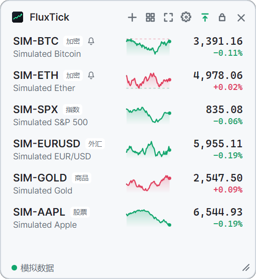
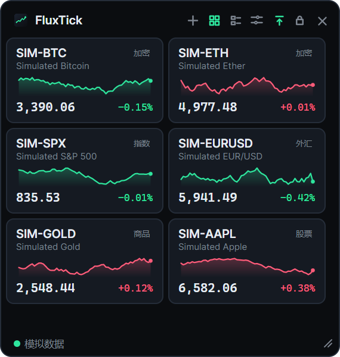
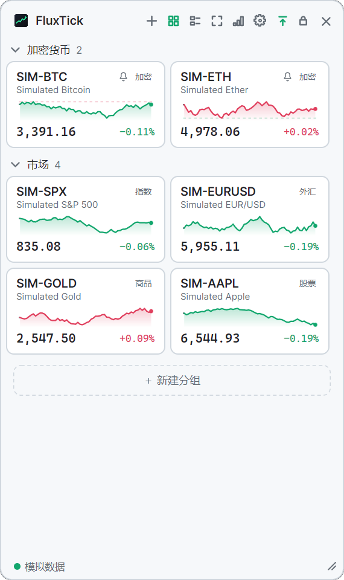
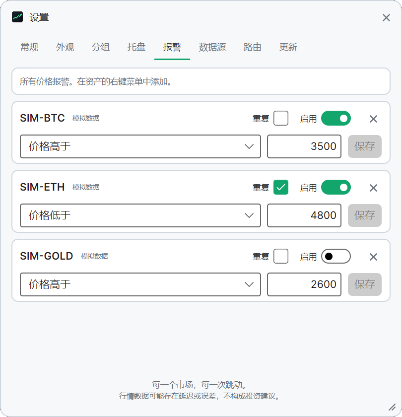

# FluxTick

[](https://github.com/coldhighsun/FluxTick/actions/workflows/ci.yml)
[](https://github.com/coldhighsun/FluxTick/releases)
[](LICENSE)
[](https://dotnet.microsoft.com/download)
[](https://avaloniaui.net/)
[](#快速开始)
[](#参与贡献)

[English](README.md) | **简体中文**

**每个市场，每一次跳动。**

一款轻量、开源的桌面小组件，让你一眼掌握多个金融市场的行情。
实时数字、迷你走势图和置顶悬浮窗口；股票、加密货币、外汇、指数与大宗商品并列展示，数据源由*你*自己选择。

<p align="center">
  
  
</p>
<p align="center">
  
  
</p>

> 截图使用内置的模拟数据源（`--demo`）。

## 功能特性

- **多资产自选列表**：加密货币、股票与 ETF、指数、外汇和大宗商品集中在同一个列表中。
- **列表或卡片**：可把自选列表切换为固定大小的卡片，窗口越宽，一行排得越多，放不下的自动换到下一行。
  卡片可按资产类型、数据源分组，也可放进自己创建的分组；每个分组都能单独折叠 / 展开，
  还可以拖动卡片调整顺序，或把卡片拖到其他自定义分组。布局和分组方式可直接在标题栏切换，
  新分组也能在当前操作的位置就地创建。
- **实时价格**：可选的价格数字滚动动画（涨时旧价向上滑出、新价从下方滑入，跌时相反；默认关闭，可在设置中开启），60 分钟迷你走势图（按时间绘制，没有报价的时段，例如第一个报价之前或休市之后，画成灰色虚线），显示相对前收盘价 / 24 小时开盘价的涨跌幅。
- **价格报警**：右键点击资产并选择**价格报警…**，即可在价格涨到或跌到某个价位时收到提醒。
  条件成立时报警触发一次（勾选**重复**则每次重新成立都会触发），在屏幕角落弹出小通知，并让该资产的卡片或行闪烁几秒；
  窗口隐藏后报警照常工作。
- **悬浮小组件**：无边框、半透明、始终置顶，可拖动、可缩放、可锁定位置，可贴边自动隐藏，并可隐藏到托盘。
- **数据源由你决定**：在**设置**中启用或停用数据源、调整其选项，并为每类资产指定默认数据源。
  还可以通过 **更换数据源…** 把任意资产切换到其他数据源。
- **如实呈现数据质量**：行情行会显示 `Stale`（过期）、`Reconnecting`（重连中）、`Source off`（数据源已关闭），
  而不是悄悄展示旧价格。超过过期阈值（默认一分钟）没有收到数据，或者持续收到的价格是更早之前成交的（例如休市），都会显示为过期。
- **界面语言**：简体中文或英文，可在运行时切换；“自动”跟随系统语言。
- **涨跌颜色**：绿涨红跌或红涨绿跌，根据界面语言自动选择（中文为红涨绿跌）。
- **跨平台**：支持 Windows、Linux 和 macOS（基于 [Avalonia](https://avaloniaui.net/) 与 .NET 10 构建）。
- **易于扩展**：新增一个数据源只需一个小型类库和一行注册代码。
  参见 [docs/ADDING_A_PROVIDER.md](docs/ADDING_A_PROVIDER.md)（英文）。

## 内置数据源

| 数据源 | 覆盖范围 | 模式 | 说明 |
| --- | --- | --- | --- |
| **Binance** | 加密货币现货交易对 | WebSocket 推送（约 1 秒） | 无需 API Key。如果所在网络无法访问 `binance.com`，请在设置中把端点改为 `wss://data-stream.binance.vision/ws` 和 `https://data-api.binance.vision`。 |
| **Yahoo Finance** | 股票、ETF、指数、外汇、期货 | 轮询（默认 5 秒） | 非官方 API，可能被限流、延迟，或在没有通知的情况下变更。无需 API Key。 |
| **Tencent Finance（腾讯财经）** | A 股、港股、美股、ETF、指数 | 轮询（默认 5 秒） | 非官方 API，可能存在延迟，或在没有通知的情况下变更。无需 API Key。支持按名称、代码或拼音搜索。分时历史（走势图回填）仅覆盖 A 股和港股，美股的走势图只能由实时报价逐步填充。默认关闭。 |
| **Sina Finance（新浪财经）** | 沪深北 A 股、ETF、指数 | 轮询（默认 5 秒） | 非官方 API，可能被限流、延迟，或在没有通知的情况下变更。无需 API Key。代码格式与腾讯相同（如 `sh600000`），同一代码两边都能用，但自选标的会固定在添加时的数据源，要改用新浪需重新添加。支持按名称或代码搜索股票和主要指数，ETF 需直接输入代码。没有分时历史，走势图由实时报价逐步填充。默认关闭。 |
| **OKX** | 加密货币现货交易对 | WebSocket 推送 | 无需 API Key。默认关闭。 |
| **Coinbase** | 加密货币现货交易对 | WebSocket 推送 | Coinbase Exchange。无需 API Key。默认关闭。 |
| **Kraken** | 加密货币现货交易对 | WebSocket 推送 | 无需 API Key。默认关闭。 |
| **Bybit** | 加密货币现货交易对 | WebSocket 推送 | 无需 API Key。部分地区无法访问。默认关闭。 |
| **Simulated（模拟）** | 任意资产 | 本地随机游走 | 用于演示、截图和离线开发。默认关闭。 |

默认关闭的数据源请在**设置 → 数据源**中启用。要显示其中的资产，可以在*添加资产*窗口中选择它，
或在*路由*标签页中把它设为某类资产的默认数据源。

> 行情数据可能存在延迟或误差，**不构成投资建议**。FluxTick 与任何数据提供方均无关联，
> 请遵守各数据提供方的使用条款。

## 快速开始

### 下载

从 [Releases](https://github.com/coldhighsun/FluxTick/releases) 页面获取最新版本：

- **Windows：** `FluxTick-<版本>-win-x64-setup.exe` 为当前用户安装（无需管理员权限）。卸载时会保留 `%APPDATA%\FluxTick` 中的设置。
  Windows 不提供免安装版。
- **Linux / macOS：** `FluxTick-<版本>-linux-x64.zip` / `FluxTick-<版本>-osx-arm64.zip`。

安装程序未做代码签名，首次运行时 Windows SmartScreen 可能会提示。

Windows 上，FluxTick 在启动时以及运行期间约每天一次检查新版本（仅检查正式版，忽略预发布版），并提示下载、校验并安装新的安装程序，完成后自动重新启动。可在 设置 → 更新 中关闭。

### 从源码运行

需要 [.NET 10 SDK](https://dotnet.microsoft.com/download)。

```bash
dotnet run --project src/FluxTick.App
```

无需联网也可以体验：

```bash
dotnet run --project src/FluxTick.App -- --demo
```

### 构建单文件可执行程序

```bash
dotnet publish src/FluxTick.App -c Release -r win-x64 -o publish
```

其他平台请使用 `linux-x64`、`osx-arm64` 等运行时标识符。产物是自包含的 `FluxTick` / `FluxTick.exe`。

### 使用方法

| 操作 | 方式 |
| --- | --- |
| 移动窗口 | 拖动标题栏（开启*锁定位置*时除外）。标题栏上“箭头指向横条”的按钮用于窗口置顶，挂锁按钮用于锁定位置 |
| 调整大小 | 拖动右下角的拖拽柄。列表布局下宽度固定（340 px，紧凑模式 260 px），只能调高度；卡片布局下宽度可自由调整，并会被记住 |
| 添加资产 | 点击标题栏的 **+**，或在空白处右键选 *Add instrument…*，打开窗口，选择资产类别和数据源后搜索 || 调整顺序 | 上下拖动某一行 |
| 删除、更换数据源 | 右键点击某一行 |
| 移动设置 / 添加窗口 | 拖动其标题栏；按 **Esc** 关闭 |
| 设置 | 点击标题栏的齿轮图标、托盘菜单的*设置*，或空白处右键菜单最下面的*设置*，打开窗口，包含*常规*、*外观*、*分组*、*托盘*（仅 Windows）、*报警*、*数据源*、*路由*和*更新*标签页；展开某个数据源即可编辑其选项，在*报警*中管理价格提醒 |
| 开机自启动 | 仅 Windows，默认关闭；在设置 → 常规中开启*开机自启动*，登录时自动启动 FluxTick |
| 启动时最小化到托盘 | 默认关闭；在设置 → 常规中开启*启动时最小化到托盘*（或使用命令行参数 `--minimized`），启动时不显示窗口，双击托盘图标即可显示（不能在托盘图标上列出资产的系统，如 Linux、macOS，单击即可） |
| 单实例 | 每个用户同时只运行一个实例；再次启动 FluxTick 会把正在运行的窗口调到前面（即使它隐藏在托盘中），而不会打开第二个 |
| 关闭按钮 | 默认点击关闭按钮会把窗口隐藏到托盘；在设置 → 常规中关闭*关闭按钮隐藏到托盘*后，点击关闭按钮将直接退出 |
| 托盘菜单 | 右键点击托盘图标，可选*显示 / 隐藏*、*设置*、*关于*和*退出*；*设置*会替换已经打开的窗口，*关于*则单独打开，不会带出主窗口 |
| 托盘列表 | 仅 Windows；单击托盘图标，即可看到托盘列表中的资产（最多五个）及其价格和涨跌幅，无需打开窗口。列表一开始是空的：在窗口中右键点击资产，选择*加入托盘列表*（或*从托盘列表移除*），再到设置 → 托盘中拖动调整顺序或移除。价格停止更新的资产会变暗并显示原因。点击其他位置或按 Esc 会关闭，再次点击图标也会关闭。双击图标则打开主窗口。鼠标停在图标上只显示应用名称和标语 |
| 恢复数据源默认值 | 在数据源展开的卡片中点击*恢复默认*，其选项会回到内置值（密钥等机密值会保留） |
| 数据源状态 | 底栏为每个在用的数据源显示一个圆点（绿色表示已连接，橙色表示未启用或出错，灰色表示空闲或重连中）。有问题的数据源排在最前；放不下时会出现 **+N** 标签。点击底栏可查看每个数据源的状态和错误信息 |
| 全屏 | 双击标题栏铺满整个屏幕；再次双击标题栏或按 Esc 键返回。原来的大小和位置会保留：无论用 Esc、双击标题栏还是全屏按钮退出，窗口都会回到全屏前的样子；在全屏状态下拖动标题栏，窗口会按原来的大小退出全屏并继续被拖动。全屏时切换到列表布局会按列表的固定宽度退出。如果在全屏状态下退出，下次启动时仍是全屏。全屏时，设置、添加资产、关于和报警窗口会显示在屏幕中央 |
| 紧凑模式 | 隐藏列表布局中的走势图。在空白处右键菜单选 *Compact*（仅列表布局下显示），或在设置中切换 |
| 卡片布局 | 点击标题栏的网格按钮在列表和卡片之间切换（在空白处右键菜单、或设置 → 外观 → *Layout* 里也可以切换） |
| 卡片大小 | 卡片布局下，可在标题栏的卡片大小按钮、空白处右键菜单的 *Card size*，或设置 → 外观 → *Card size* 中选择*小*、*中*、*大*。小卡片只显示代码和价格（其余信息在悬停提示里），中卡片是原来的样子，大卡片增加更高的走势图、涨跌额与涨跌幅、参考价以及 60 分钟最低 / 最高价 |
| 卡片分组 | 卡片布局下，点击标题栏的分组按钮（或在空白处右键，或设置 → 外观 → *Card grouping*）可选 *No grouping*（不分组）、*By type*（按类型）、*By data source*（按数据源）或 *Custom groups*（自定义分组）；点击分组标题可折叠 / 展开，按住类型分组或自定义分组的标题拖动可调整分组顺序 |
| 自定义分组 | 一开始就有一个 *Default* 分组，新添加的资产进入第一个分组。新建分组的入口：分组按钮 → *New group…*、空白处右键菜单、卡片右键菜单（*Move to new group…* 会把这张卡放进新分组）、最后一个分组下方的虚线 *New group* 占位（也可以把卡片拖到它上面）。双击分组标题可就地改名；右键分组标题可选 *Rename…*（重命名）和 *Delete group*（删除分组），只有没有资产、且不是最后一个的分组才能在这里删除（空分组下方也有 *Delete group* 链接）。在其他分组方式下新建分组会自动切到 *Custom groups*，并出现 *Undo*（撤销）提示可切回去。在设置 → Groups 中可以按住分组拖动排序，也可以删除分组（在那里删除分组，其资产会移入剩余的第一个分组）；右键卡片选 *Move to group*，或直接把卡片拖到分组里 |
| 价格滚动 | 默认关闭；在空白处右键菜单，或设置 → 外观中开启 *价格变动时数字滚动*。只有价格数字会滚动（涨时向上，跌时向下）；整张卡片或整行闪烁几秒表示有报警触发，与这个设置无关 |
| 贴边自动隐藏 | 默认开启；可在设置 → 常规中关闭*贴边自动隐藏*（需要保持窗口置顶；在系统不让窗口留在屏幕外的环境下不可用）。把窗口拖到屏幕左、右或上边缘后会滑出屏幕，只留一条细边；鼠标靠近细边（或双击托盘图标）时窗口滑出；鼠标进入窗口后移开，窗口会再次隐藏；用托盘图标滑出的窗口会一直留着，直到在托盘菜单中选择*显示 / 隐藏* |
| 隐藏 / 显示 | 点击 **×** 隐藏到托盘（关闭*关闭按钮隐藏到托盘*后则直接退出）；双击托盘图标重新显示（不能在托盘图标上列出资产的系统上，单击即可显示和隐藏窗口）；托盘菜单中的*显示 / 隐藏*可再次隐藏，*退出*用于关闭程序。窗口隐藏期间价格仍会持续更新，因此程序运行期间，观察列表中有资产的数据源会一直保持连接 |

设置和日志保存在 Windows 的 `%APPDATA%\FluxTick`，以及 Linux 和 macOS 的 `~/.config/FluxTick`。日志在 `logs` 文件夹中：每天一个文件，单个文件达到 10 MB 时提前拆分，只保留最新的 5 个文件（因此最多是最近 5 天，日志量大的日子会更少），更早的文件会被自动删除。每次价格更新都会重复出现的问题（例如某个处理器一直出错）每分钟最多记录一次，并注明被合并的重复次数。
处于内置默认值的选项不会写入 `settings.json`。删除该文件即可重置全部设置。

## 项目结构

```
src/FluxTick.Abstractions        稳定的数据源契约（数据源只需引用它）
src/FluxTick.Core                数据源注册、路由、行情聚合、走势序列、设置
src/FluxTick.Providers.Common    数据源共用的辅助代码（WebSocket 与轮询基类、符号搜索）
src/FluxTick.Providers.Binance   Binance WebSocket 数据源
src/FluxTick.Providers.Okx       OKX WebSocket 数据源
src/FluxTick.Providers.Coinbase  Coinbase WebSocket 数据源
src/FluxTick.Providers.Kraken    Kraken WebSocket 数据源
src/FluxTick.Providers.Bybit     Bybit WebSocket 数据源
src/FluxTick.Providers.Yahoo     Yahoo Finance 轮询数据源
src/FluxTick.Providers.Tencent   腾讯财经轮询数据源
src/FluxTick.Providers.Sina      新浪财经轮询数据源
src/FluxTick.Providers.Simulated 确定性的演示数据源
src/FluxTick.App                 Avalonia 桌面应用（FluxTick.exe），组合根
tests/                           xUnit v3 + AwesomeAssertions
```

```bash
dotnet build FluxTick.slnx
dotnet test --solution FluxTick.slnx
```

## 参与贡献

欢迎提交 Issue 和 Pull Request。请随改动一并添加或更新测试。新增数据源是最有价值的贡献，
请从 [docs/ADDING_A_PROVIDER.md](docs/ADDING_A_PROVIDER.md)（英文）开始。

## 许可证

[MIT](LICENSE)
