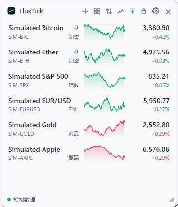
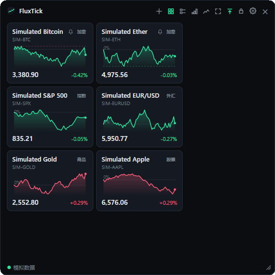
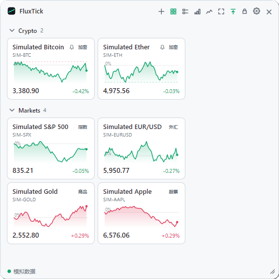
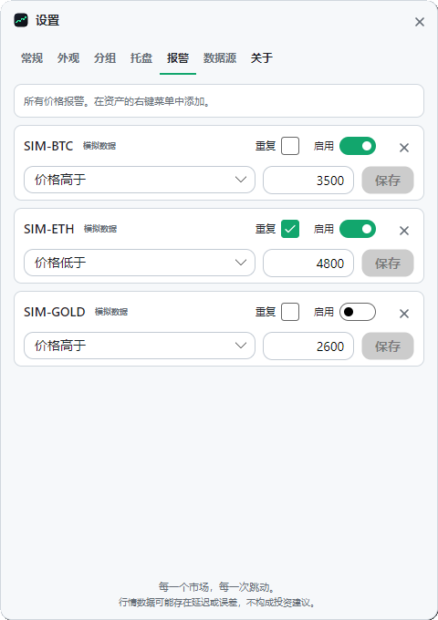
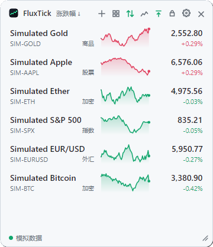
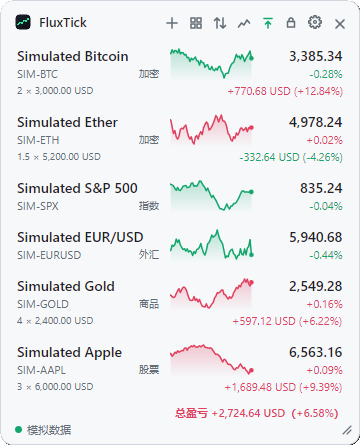
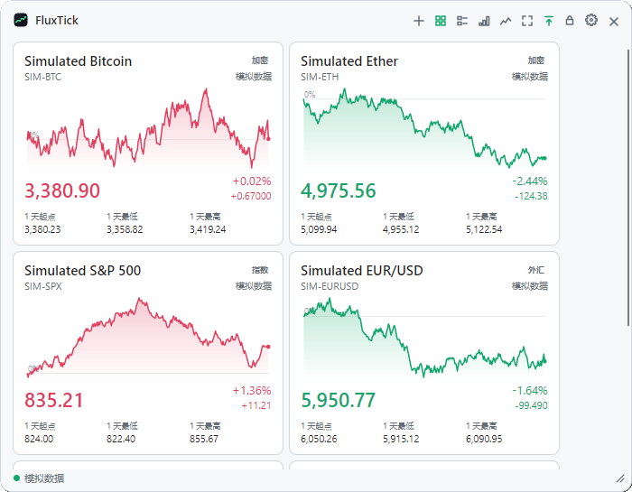
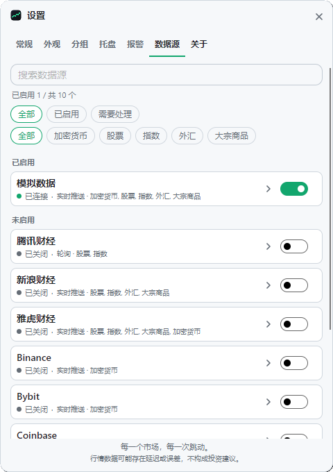

# FluxTick

[](https://github.com/coldhighsun/FluxTick/actions/workflows/ci.yml)
[](https://codecov.io/gh/coldhighsun/FluxTick)
[](https://github.com/coldhighsun/FluxTick/releases/latest)
[](https://github.com/coldhighsun/FluxTick/releases)
[](https://github.com/coldhighsun/FluxTick/releases)
[](LICENSE)
[](https://dotnet.microsoft.com/download)
[](https://avaloniaui.net/)
[](#快速開始)
[](#參與貢獻)

[English](README.md) | [简体中文](README.zh-CN.md) | **繁體中文**

**每個市場，每一次跳動。**

一款輕量、開源的桌面小工具，讓你一眼掌握多個金融市場的行情。
即時數字、迷你走勢圖和置頂浮動視窗；股票、加密貨幣、外匯、指數與大宗商品並列顯示，資料來源由*你*自己選擇。

<p align="center">
  
  
</p>
<p align="center">
  
  
</p>

<p align="center">
  
  
</p>
<p align="center">
  
  
</p>

> 截圖使用內建的模擬資料來源（`--demo`），介面為簡體中文。

## 功能特色

- **多資產自選清單**：加密貨幣、股票與 ETF、指數、外匯和大宗商品集中在同一個清單中。
- **清單或卡片**：可把自選清單切換為卡片，視窗越寬，一列排得越多。卡片可依資產類型、資料來源分組，
  也可放進自己建立的群組；每個群組都能單獨摺疊 / 展開，卡片可拖曳排序，或拖到其他群組。
- **即時價格**：迷你走勢圖（依時間繪製，沒有報價的時段畫成虛線），顯示相對前收盤價 / 24 小時開盤價的漲跌幅，
  另有可選的價格數字滾動動畫（預設關閉）。
- **走勢圖時間跨度**：走勢圖預設顯示最近一小時，點擊標題列的走勢圖按鈕可切換為 1 天、5 天、1 個月、6 個月或 1 年，
  並顯示百分比座標軸、懸停提示和該跨度內的漲跌。不支援更長跨度的資料來源仍顯示最近一小時。
- **清單排序**：清單版面可依日漲跌幅或持倉損益百分比排序，休市的列排在開市的列之後。
- **市場狀態**：行情列依交易所交易時間顯示盤前、盤後、午休和休市。
- **價格警示**：在資產上按右鍵並選擇**價格警示…**，價格漲到或跌到某個價位時收到提醒。
  警示觸發一次（勾選**重複**則每次重新成立都會觸發），彈出小通知並讓該卡片或列閃爍；視窗隱藏後警示照常運作。
- **持倉與損益**：在資產上按右鍵並選擇**持倉成本…**，填寫成本價、數量和幣別，列、卡片、懸停提示和系統匣彈窗就會顯示損益；
  總損益依你選擇的基準幣別（設定 → 一般）彙總。匯率來自免費的 [Frankfurter](https://frankfurter.dev) 服務
  （歐洲央行參考匯率），每小時更新一次。價格已過期或資料來源出錯的持倉不計入總額，總額後面會註明有幾項。
- **浮動小工具**：無邊框、半透明、始終置頂，可拖曳、可縮放、可鎖定位置，可貼邊自動隱藏，並可隱藏到系統匣。
- **資料來源由你決定**：在**設定**中啟用或停用資料來源、調整其選項，並為每類資產指定預設資料來源。
  還可以透過**更換資料來源…**把任意資產切換到其他資料來源。
- **如實呈現資料品質**：行情列會顯示 `Stale`（資料過期）、`Delayed`（報價延遲）、`Reconnecting`（重新連線中）或 `Source off`（資料來源已關閉），
  而不是悄悄顯示舊價格。持續收到資料但價格是更早之前成交的（超過過期閾值，預設一分鐘，且不超過 30 分鐘，例如延遲行情），即為延遲；
  超過閾值沒有收到資料，或收到的價格已是 30 分鐘前成交的（例如來源卡住、休市），即為過期。
  過期的價格不計入持倉總額（休市除外），延遲的價格仍會計入；資料來源過期、延遲或重新連線期間警示會等待。
- **介面語言**：簡體中文、繁體中文或英文，可在執行時切換；「自動」跟隨系統語言。
- **漲跌顏色**：綠漲紅跌或紅漲綠跌，依介面語言自動選擇（中文為紅漲綠跌）。
- **跨平台**：支援 Windows、Linux 和 macOS（基於 [Avalonia](https://avaloniaui.net/) 與 .NET 10 建置）。
- **易於擴充**：新增一個資料來源只需一個小型類別庫和一行註冊程式碼。
  參見 [docs/ADDING_A_PROVIDER.md](docs/ADDING_A_PROVIDER.md)（英文）。

## 內建資料來源

| 資料來源 | 涵蓋範圍 | 模式 | 說明 |
| --- | --- | --- | --- |
| **Binance** | 加密貨幣現貨交易對 | WebSocket 推送（約 1 秒） | 無需 API Key。如果無法連線 `binance.com`，請在設定中把端點改為 `wss://data-stream.binance.vision/ws` 和 `https://data-api.binance.vision`。 |
| **Yahoo Finance** | 股票、ETF、指數、外匯、期貨、加密貨幣 | WebSocket 推送 | 非官方 API，可能被限流或無通知變更。無需 API Key。**A 股和港股行情有 15 分鐘延遲**，因此會顯示為報價延遲；需要 A 股即時行情請使用新浪或騰訊。推送中斷期間改為輪詢圖表 API（預設 5 秒）。 |
| **Tencent Finance（騰訊財經）** | A 股、港股、美股、ETF、指數 | 輪詢（預設 5 秒） | 非官方 API，可能延遲或無通知變更。無需 API Key。支援依名稱、代碼或拼音搜尋。走勢圖歷史僅涵蓋 A 股和港股。預設關閉。 |
| **Sina Finance（新浪財經）** | A 股、ETF、指數、外匯、國際商品期貨 | WebSocket 推送 | 非官方 API，可能被限流、延遲或無通知變更。無需 API Key。代碼格式與騰訊相同（如 `sh600000`），但自選標的會固定在新增時的資料來源。可搜尋股票、主要指數和常用外匯、期貨；ETF 需直接輸入代碼，其他外匯（`fx_seurusd`）和期貨（`hf_GC`）輸入新浪的代碼。走勢圖歷史涵蓋 A 股、基金和外匯。預設關閉。 |
| **Eulerpool** | 全球股票和 ETF（代碼帶交易所後綴，如 `AAPL`、`SAP.DE`） | WebSocket 推送 | 需要 API Key（在 eulerpool.com/developers 免費申請，詳見 [API Key](#api-key)）。免費 Key 只能收到延遲的 1 秒行情，即時成交需要付費方案。支援依名稱、代碼或 ISIN 搜尋。預設關閉。 |
| **OKX** | 加密貨幣現貨交易對 | WebSocket 推送 | 無需 API Key。預設關閉。 |
| **Coinbase** | 加密貨幣現貨交易對 | WebSocket 推送 | Coinbase Exchange。無需 API Key。預設關閉。 |
| **Kraken** | 加密貨幣現貨交易對 | WebSocket 推送 | 無需 API Key。預設關閉。 |
| **Bybit** | 加密貨幣現貨交易對 | WebSocket 推送 | 無需 API Key。部分地區無法連線。預設關閉。 |
| **Simulated（模擬）** | 任意資產 | 本機隨機漫步 | 用於示範、截圖和離線開發。預設關閉。 |

預設關閉的資料來源請在**設定 → 資料來源**中啟用。要顯示其中的資產，可以在*新增資產*視窗中選擇它，
或在*資料來源*分頁中拖曳資料來源排序：支援某類資產的、已啟用的第一個資料來源就是該類資產的預設資料來源。

> 行情資料可能存在延遲或誤差，**不構成投資建議**。FluxTick 與任何資料提供方均無關聯，
> 請遵守各資料提供方的使用條款。

## 快速開始

### 下載

從 [Releases](https://github.com/coldhighsun/FluxTick/releases) 頁面取得最新版本：

- **Windows：** `FluxTick-<版本>-win-x64-setup.exe` 為目前使用者安裝（無需管理員權限）。解除安裝時會保留 `%APPDATA%\FluxTick` 中的設定。安裝程式支援英文、簡體中文和繁體中文。
- **Windows（可攜版）：** `FluxTick-<版本>-win-x64-portable.zip` 內只有一個 `FluxTick.exe`，解壓縮到任意位置即可執行，無需安裝。
- **Linux：** `FluxTick-<版本>-linux-x64.zip` 內只有一個 `FluxTick` 可執行檔。
- **macOS（Apple Silicon）：** `FluxTick-<版本>-osx-arm64.dmg` 內含 `FluxTick.app`，參見下方 [macOS 安裝](#macos-安裝)。
- **macOS（Homebrew）：** `brew install --cask coldhighsun/tap/fluxtick`

> **請勿在同一台電腦上同時使用可攜版和安裝版。** 兩者共用 `%APPDATA%\FluxTick` 中的設定，並且各自註冊指向自己
> `FluxTick.exe` 的*開機自動啟動*項，會互相衝突（登入時可能啟動了錯誤的那一份，或啟動項被覆蓋）。內建更新功能
> 下載的是安裝程式，可攜版自動更新後也會變成安裝版。請二選一；切換前先解除安裝安裝版（或刪除可攜版資料夾）。

安裝程式和可攜版均未做程式碼簽署，首次執行時 Windows SmartScreen 可能會提示。

#### macOS 安裝

macOS 版本僅做了 ad-hoc 簽署：沒有 Apple Developer ID 簽署，也未經公證。因此 macOS 的 Gatekeeper 會在首次啟動時攔截
（提示「無法打開，因為無法驗證開發者」或「已損毀」），不能直接雙擊執行，需要手動放行一次：

1. 打開 `.dmg`，把 `FluxTick.app` 拖到「應用程式」。
2. 從「應用程式」中打開 FluxTick，macOS 會拒絕並彈出提示。
3. 打開*系統設定 → 隱私權與安全性*，捲動到關於 FluxTick 的提示，點擊*仍要打開*並確認。（macOS 14 及更早版本也可以
   按右鍵點擊應用程式選擇*打開*；macOS 15 起已移除該方式。）

透過 Homebrew 安裝會自動移除隔離屬性，安裝後可直接打開：

```bash
brew install --cask coldhighsun/tap/fluxtick
```

之後 `brew upgrade` 即可升級到新的穩定版。

也可以在首次啟動前，在終端機中移除隔離屬性：

```bash
xattr -dr com.apple.quarantine /Applications/FluxTick.app
```

macOS 上的注意事項：

- 僅建置 Apple Silicon（M1 及更新），沒有 Intel 版本；需要 macOS 12 或更高版本。
- 老闆鍵和*開機自動啟動*僅限 Windows，macOS 上無法使用。點擊選單列圖示會彈出資產清單，圖示本身沒有選單，
  *顯示/隱藏*、*設定*和*結束*放在清單底部。
- 暫未接入鑰匙圈：API Key 以明文（檔案權限 600）儲存在 `~/.config/FluxTick`，設定和記錄檔也在該目錄。
- 程式是單檔自解壓縮，首次啟動可能多花幾秒。
- 更新不會自動安裝：FluxTick 只下載並驗證新的 `.dmg` 並提示你，需自行取代「應用程式」中的 app。

Windows 上，FluxTick 在啟動時以及執行期間約每天一次檢查新版本（僅檢查正式版，忽略預先發佈版），並提示下載、驗證並安裝新的安裝程式，完成後自動重新啟動。可在 設定 → 關於 中關閉。

### 從原始碼執行

需要 [.NET 10 SDK](https://dotnet.microsoft.com/download)。

```bash
dotnet run --project src/FluxTick.App
```

無需連網也可以體驗：

```bash
dotnet run --project src/FluxTick.App -- --demo
```

### 建置單檔可執行程式

```bash
dotnet publish src/FluxTick.App -c Release -r win-x64 -o publish
```

其他平台請使用 `linux-x64`、`osx-arm64` 等執行階段識別碼。產物是自包含的 `FluxTick` / `FluxTick.exe`。

### 使用方法

| 操作 | 方式 |
| --- | --- |
| 移動視窗 | 拖曳標題列（開啟*鎖定位置*時除外）。標題列上「箭頭指向橫條」的按鈕用於視窗置頂，掛鎖按鈕用於鎖定位置 |
| 調整大小 | 拖曳右下角的拖曳控點。清單版面下寬度固定（340 px，精簡模式 260 px），只能調高度；卡片版面下寬度可自由調整，並會被記住 |
| 新增資產 | 點擊標題列的 **+**，或在空白處按右鍵選 *Add instrument…*，選擇資產類別和資料來源後搜尋 |
| 調整順序 | 上下拖曳某一列 |
| 刪除、更換資料來源 | 在某一列上按右鍵 |
| 移動設定 / 新增視窗 | 拖曳其標題列；按 **Esc** 關閉 |
| 設定 | 點擊標題列的齒輪圖示、系統匣選單的*設定*，或空白處右鍵選單最下面的*設定*。分頁：*一般*、*外觀*、*群組*、*系統匣*（僅 Windows）、*警示*、*資料來源*和*關於*（更新設定也在這裡）。展開某個資料來源可編輯其選項，拖曳資料來源可調整優先順序 |
| 開機自動啟動 | 僅 Windows，預設關閉；設定 → 一般 |
| 啟動時最小化到系統匣 | 預設關閉；設定 → 一般（或命令列參數 `--minimized`），啟動時不顯示視窗，雙擊系統匣圖示顯示（不能在系統匣圖示上列出資產的系統，即 Windows 以外，單擊即可） |
| 單一執行個體 | 每個使用者只執行一個執行個體；再次啟動會把正在執行的視窗調到前面，即使它隱藏在系統匣中 |
| 關閉按鈕 | 預設隱藏到系統匣；在設定 → 一般中關閉*關閉按鈕隱藏到系統匣*後直接結束 |
| 系統匣選單 | 在系統匣圖示上按右鍵，可選*顯示 / 隱藏*、*設定*和*結束* |
| 系統匣清單 | 僅 Windows；單擊系統匣圖示，無需打開視窗即可看到最多五個資產的價格和漲跌幅。在資產上按右鍵選擇*加入系統匣清單*（或*從系統匣清單移除*），在設定 → 系統匣中調整順序。價格停止更新的資產會變暗並顯示原因。按 Esc 或點擊其他位置關閉；雙擊圖示打開主視窗 |
| 恢復資料來源預設值 | 在資料來源展開的卡片中點擊*恢復預設*，其選項會回到內建值（金鑰等機密值會保留） |
| 資料來源狀態 | 底列為每個在用的資料來源顯示一個圓點（綠色已連線，橘色未啟用或出錯，灰色閒置或重新連線中），有問題的排在最前，放不下時出現 **+N** 標籤。點擊底列可查看每個資料來源的狀態和錯誤訊息 |
| 全螢幕 | 雙擊標題列鋪滿螢幕；再次雙擊或按 Esc 返回原來的大小和位置。全螢幕時拖曳標題列會結束全螢幕並繼續拖曳。在全螢幕狀態下結束，下次啟動仍是全螢幕 |
| 精簡模式 | 隱藏清單版面中的走勢圖（空白處右鍵選單，或設定） |
| 卡片版面 | 點擊標題列的格狀按鈕在清單和卡片之間切換（空白處右鍵選單、設定 → 外觀裡也可以） |
| 卡片大小 | 卡片版面下，可在標題列、右鍵選單或設定 → 外觀中選擇*小*、*中*、*大*。小卡片只顯示代碼和價格（其餘在懸停提示裡），大卡片增加更高的走勢圖、漲跌額與漲跌幅、參考價以及 60 分鐘最低 / 最高價 |
| 卡片分組 | 卡片版面下，點擊標題列的分組按鈕（或右鍵選單、設定 → 外觀）可選*不分組*、*依類型*、*依資料來源*或*自訂群組*。點擊群組標題摺疊 / 展開，拖曳類型或自訂群組的標題可調整順序 |
| 自訂群組 | 一開始就有一個 *Default* 群組，新資產進入第一個群組。新增群組：分組按鈕 → *New group…*、空白處右鍵選單，或卡片右鍵選單的 *Move to new group…*。雙擊群組標題改名；在群組標題上按右鍵可選 *Rename…* 和 *Delete group*（僅限沒有資產且不是最後一個的群組）。移動卡片：右鍵 → *Move to group*，或直接拖到群組裡。設定 → Groups 中可排序和刪除群組（在那裡刪除，其資產會移入剩餘的第一個群組） |
| 價格滾動 | 預設關閉；在空白處右鍵選單或設定 → 外觀中開啟。只有價格數字會滾動；卡片或列閃爍表示有警示觸發，與這個設定無關 |
| 貼邊自動隱藏 | 預設開啟（需要視窗置頂；在系統不讓視窗留在螢幕外的環境下無法使用），可在設定 → 一般中關閉。把視窗拖到螢幕左、右或上邊緣後會滑出螢幕，只留一條細邊；滑鼠靠近細邊或雙擊系統匣圖示時滑出，移開後再次隱藏（用系統匣圖示滑出的除外） |
| 隱藏 / 顯示 | 有系統匣圖示時，視窗沒有工作列按鈕（也不在 Alt+Tab 中）。點擊 **×** 隱藏到系統匣（或直接結束，見*關閉按鈕*）；雙擊系統匣圖示重新顯示（不能在系統匣圖示上列出資產的系統上單擊即可）；系統匣選單的*結束*用於關閉程式。隱藏期間價格仍會更新，觀察清單中有資產的資料來源保持連線 |
| 老闆鍵 | 全域快速鍵（預設 **Ctrl+Alt+H**）一鍵隱藏所有視窗和系統匣圖示，再按一次恢復。在設定 → 一般中點擊輸入框後按下新的組合鍵即可修改（至少一個 Ctrl、Alt、Shift 或 Win，加上字母、數字、F 鍵、方向鍵、導覽鍵或標點鍵；按退格鍵關閉）。隱藏期間行情照常更新，警示通知和更新提示會等視窗恢復後再彈出。僅限 Windows |

設定和記錄檔儲存在 Windows 的 `%APPDATA%\FluxTick`，以及 Linux 和 macOS 的 `~/.config/FluxTick`；設定 → 一般中有按鈕可直接打開這些資料夾。記錄檔每天一個檔案（達到 10 MB 時提前拆分），只保留最新的 5 個檔案。每次價格更新都會重複出現的問題每分鐘最多記錄一次。
處於內建預設值的選項不會寫入 `settings.json`。每次儲存前，原檔案會保留為 `settings.json.bak`；設定檔遺失或損毀時會從它恢復。如需重設全部設定，請先結束程式，再同時刪除 `settings.json` 和 `settings.json.bak`。

### API Key

部分資料來源需要 API Key（目前只有 Eulerpool；這類資料來源預設關閉，需要在設定 → 資料來源中填入 Key 後再啟用）。Key 在遮罩輸入框中填寫，處理方式如下：

- **儲存位置：** 儲存在 `settings.json` 中，與其他設定在同一資料夾；同一資料夾中的設定檔副本裡也有（`settings.json.bak` 是上次儲存前的檔案，`settings.json.bad` 是被移開的損毀檔案）。不會儲存到其他任何地方，不會寫入記錄檔，也不會拼進 URL；只會傳送給它所屬的資料來源。
- **Windows：** Key 使用 Windows 資料保護 API（DPAPI）依目前使用者帳戶加密，以 `protected:v1:…` 的形式寫入檔案。只有同一台電腦上的同一使用者才能解開，並且每個 Key 都綁定到各自的資料來源和選項，不能挪給別的選項使用。舊版本以明文儲存的 Key 會在首次啟動時自動加密；設定檔副本裡仍可能是明文：`settings.json.bak` 會保留到下次修改設定時被取代，`settings.json.bad` 會一直保留到你手動刪除。
- **Linux 和 macOS：** 目前沒有內建的保護，Key 以明文儲存。檔案建立時僅目前使用者可讀寫（權限 `600`），因此隱私程度取決於你的使用者帳戶。
- **侷限：** DPAPI 無法阻止以同一使用者身分執行的其他程式讀取 Key，程式執行期間 Key 也會以明文存在於記憶體中。請不要分享 `settings.json`，也不要把它貼到 Issue 裡；貼之前請先刪掉 Key。
- **Key 無法解開時**（檔案被複製到其他帳戶或電腦，或檔案損毀），資料來源會要求重新填寫。資料來源保持啟用期間，檔案中的舊內容會保留，所以不相關的設定變更不會讓它遺失；填入新 Key 會取代它，關閉該資料來源則會放棄它。
- 資料來源的*恢復預設*會保留其中的 Key。

## 專案結構

```
src/FluxTick.Abstractions        穩定的資料來源契約（資料來源只需參考它）
src/FluxTick.Core                資料來源註冊、路由、行情彙整、走勢序列、設定
src/FluxTick.Providers.Common    資料來源共用的輔助程式碼（WebSocket 與輪詢基底類別、代碼搜尋）
src/FluxTick.Providers.Binance   Binance WebSocket 資料來源
src/FluxTick.Providers.Okx       OKX WebSocket 資料來源
src/FluxTick.Providers.Coinbase  Coinbase WebSocket 資料來源
src/FluxTick.Providers.Kraken    Kraken WebSocket 資料來源
src/FluxTick.Providers.Bybit     Bybit WebSocket 資料來源
src/FluxTick.Providers.Yahoo     Yahoo Finance WebSocket 資料來源
src/FluxTick.Providers.Tencent   騰訊財經輪詢資料來源
src/FluxTick.Providers.Sina      新浪財經 WebSocket 資料來源
src/FluxTick.Providers.Eulerpool  Eulerpool WebSocket 資料來源（需 API Key）
src/FluxTick.Providers.Simulated 確定性的示範資料來源
src/FluxTick.App                 Avalonia 桌面應用程式（FluxTick.exe），組合根
tests/                           xUnit v3 + AwesomeAssertions
```

```bash
dotnet build FluxTick.slnx
dotnet test --solution FluxTick.slnx
```

## 參與貢獻

歡迎提交 Issue 和 Pull Request。請隨變更一併新增或更新測試。新增資料來源是最有價值的貢獻，
請從 [docs/ADDING_A_PROVIDER.md](docs/ADDING_A_PROVIDER.md)（英文）開始。

## 授權條款

[MIT](LICENSE)
